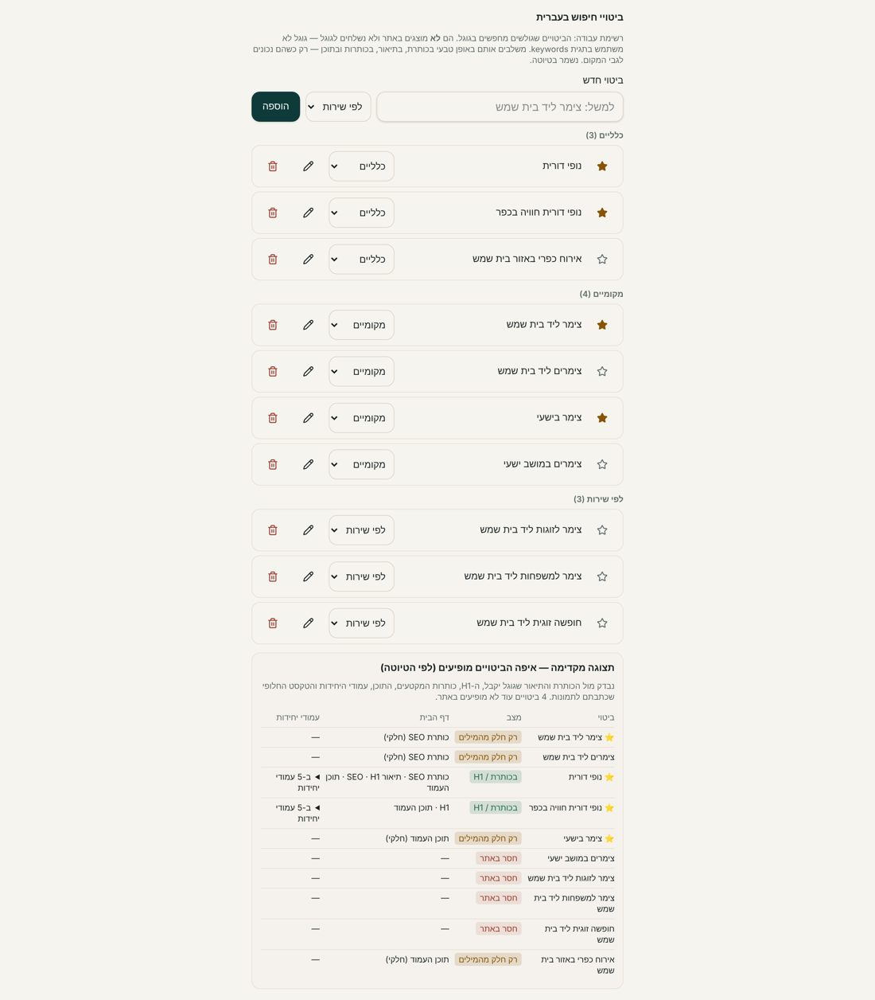
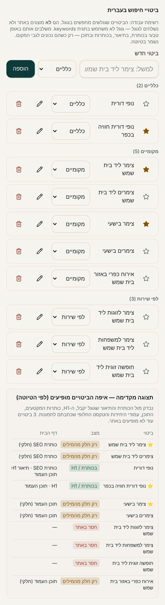

# נופי דורית — Google: אינדוקס, SEO בעברית וקידום מקומי

> **מצב:** בדיקה **קריאה בלבד** של האתר החי (17.11.2026, `https://nofi-dorit.nuri1.fit`) + שינויי קוד בענף העבודה
> `claude/ecstatic-euler-z7wmrg` בלבד. **שום דבר לא נפרס, שום דבר לא נכתב למסד בייצור, אין שינוי בחשבון Google.**
> ביטויי החיפוש נשמרים **כטיוטה**. אין כאן הבטחה לדירוג בגוגל — רק התאמה טובה יותר של התוכן האמיתי לחיפושים.

**בסיס הקוד:** `hospitality/tracking-settings` (`bd7771f`) — הקוד שרץ בייצור מ-17.11.2026 (`eccd001`) + רישום הפריסה. קוד
הצימרים (`src/engines/hospitality`) לא קיים ב-`main` (שם רק החנויות).
**החנויות אונליין לא מושפעות:** כל השינויים בתיקיות של Hospitality (קוד, בדיקות, סקריפט, תיעוד). אין מיגרציה, אין
שינוי בקבצים משותפים, ואין פריסה. (החנויות והצימרים רצים באותה אפליקציה ובאותו מסד — ולכן ההקפדה.)

> הקובץ לא היה קיים במאגר לפני הבדיקה הזו. חלק א' הוא בדיקת האינדוקס של היום; חלק ב' הוא הפרק החדש.

---

## חלק א' — אינדוקס (קריאה בלבד, 17.11.2026)

| בדיקה                  | תוצאה                                                                                                                                                   |
| ---------------------- | ------------------------------------------------------------------------------------------------------------------------------------------------------- |
| `/`                    | **301** → `/stay` ✅                                                                                                                                    |
| `/stay` (כ-Googlebot)  | 200, `index, follow`, canonical לעצמו ✅                                                                                                                |
| robots.txt             | פתוחים: `/`, `/stay`, יחידות, סוגי חדרים, חבילות, קבצי מותג, CSS/JS/גופנים, sitemap. כל השאר חסום ✅                                                    |
| sitemap.xml            | **6 כתובות:** הבית + 5 יחידות (כולל "אירוע באזור הבריכה עד 50 איש", שנוספה אחרי הצילום מ-9.11). כולן 200, `index, follow`, canonical לעצמן ✅           |
| `lastmod`              | רק לדף הבית (`2026-11-17`); ליחידות אין — לא תקלה (גוגל לא מחייב), שיפור אפשרי בעתיד                                                                    |
| עמודים פרטיים          | `/stay/book`, `/stay/my-booking`, `/stay/privacy`, `/stay/accessibility` — חסומים ב-robots.txt **וגם** `noindex, nofollow` ✅                           |
| אימות Search Console   | תגית `google-site-verification` קיימת בדף הבית (`RE1mRQ…`) — כלומר הנכס נוסף ואומת ✅                                                                   |
| מדידה לפני הסכמה       | אין `googletagmanager` בעמוד לפני "אישור" ✅                                                                                                            |
| מצב האינדקס בגוגל עצמו | **לא ניתן לבדוק מכאן** — אין לסשן גישה ל-Search Console. לבדוק בחשבון: **דפים** (כמה מתוך 6 באינדקס) ו**בדיקת כתובת** לכל יחידה; ושה-sitemap נשלח ונקרא |

**המלצה אחת לפני כל קידום:** להחליט על הכתובת הקבועה. היום ה-canonical הוא `nofi-dorit.nuri1.fit`. אם מתוכנן דומיין
משלו — לחבר אותו **לפני** שמפרסמים את הקישור ב-Google Business Profile, ברשתות ובאתרים אחרים (אחרת כל הקישורים יצטרכו
לעבור הפניה).

---

## חלק ב' — SEO בעברית וקידום מקומי

### ב1. ניהול ביטויי חיפוש — מה נבנה (בענף, לא נפרס)

**איפה:** ניהול העסק → **האתר** → לשונית **גוגל ושיתוף** → "ביטויי חיפוש בעברית" (בין "תוצאת החיפוש בגוגל" ל"שיתוף").
בעל העסק ומנהל הפלטפורמה (שעובד מתוך ניהול העסק, כמו בשמירת GA4) — אותו מסך, אותן הרשאות של עורך האתר.

| דרישה                     | איך                                                                                                                                             |
| ------------------------- | ----------------------------------------------------------------------------------------------------------------------------------------------- |
| רשימת ביטויים             | מקובצת: **כלליים / מקומיים / לפי שירות**, עם מונה לכל קבוצה                                                                                     |
| הוספה                     | שדה + בחירת סוג. נבדק: ריק, ארוך מ-80 תווים, כפול (גם עם ניקוד / רווחים), עד 60 ביטויים                                                         |
| עריכה / מחיקה / שינוי סוג | בכל שורה. עריכה שומרת את אותו מזהה                                                                                                              |
| ביטויים מרכזיים           | כוכב בכל שורה (`aria-pressed`)                                                                                                                  |
| שמירה נפרדת לכל עסק       | בתוך מסמך האתר (`design.seo.keywords`) בטבלה `hospitality.site_versions` — לפי tenant, עם RLS. **בלי מיגרציה**                                  |
| טיוטה                     | נשמר אוטומטית בטיוטת האתר. נכנס לגרסה מפורסמת רק כשלוחצים "פרסום" באתר                                                                          |
| תצוגה מקדימה לפני פרסום   | טבלה "איפה הביטויים מופיעים (לפי הטיוטה)": לכל ביטוי — מצב, ואיפה בדף הבית ובעמודי היחידות (כותרת SEO, תיאור SEO, H1, כותרות, תוכן, טקסט חלופי) |
| אזהרות "דחיסה"            | אותו ביטוי פעמיים בכותרת / בתיאור, או יותר מ-3 ביטויים בכותרת (4 בתיאור) — אזהרה בלבד                                                           |

**מה הביטויים לא עושים — בכוונה:**

- **אין `<meta name="keywords">`.** גוגל לא משתמש בה לדירוג.
- **אין טקסט מוסתר ואין רשימות באתר.** הביטויים לא מוצגים לגולשים בשום צורה.
- **הם לא מגיעים לדפדפן:** `withoutKeywords` מסיר אותם מנתוני האתר שנשלחים לעמוד (`toPublicSite`) — גם אחרי פרסום. (הם
  נשארים במסד, בגרסה המפורסמת, כמו שאר מסמך האתר.)
- **הם לא משנים שום טקסט באתר.** הם כלי בדיקה: בעל העסק משלב ביטוי בכותרת / בתיאור / בתוכן בעצמו, רק כשהוא נכון.

**ההתאמה בעברית:** בלי ניקוד וגרשיים (ג׳קוזי = ג'קוזי); אותיות השימוש ו/ה/ב/ל/מ/ש/כ לפני מילה ("בישעי" ↔ "ישעי");
"ברצף" — הביטוי כמו שהוא; "רק חלק מהמילים" — כל המילים קיימות, לא ברצף (כולל ריבוי: צימר ↔ צימרים).

בטלפון

**הקבצים:**

| קובץ                                                              | מה                                                                                  |
| ----------------------------------------------------------------- | ----------------------------------------------------------------------------------- |
| `src/engines/hospitality/website/seo-keywords.ts`                 | חדש. בדיקת הרשימה, ההתאמה בעברית, הדוח, אזהרות דחיסה (טהור)                         |
| `src/engines/hospitality/website/seo-keywords-report.ts`          | חדש. הדוח לפי הטיוטה — עם אותן פונקציות שבונות את כותרות האתר (`siteHomeHead` וכו') |
| `src/engines/hospitality/management/website/SeoKeywordsPanel.tsx` | חדש. המסך                                                                           |
| `src/engines/hospitality/management/website/SeoFields.tsx`        | המסך נוסף ללשונית "גוגל ושיתוף"                                                     |
| `src/engines/hospitality/website/design/schema.ts`                | `SiteSeo.keywords` + בדיקה ב-`normalizeSeo` (כמו כל שדה SEO)                        |
| `src/engines/hospitality/website/lib/site-map.ts`                 | `withoutKeywords` — הביטויים לא נשלחים לדפדפן                                       |
| `src/engines/hospitality/website/head.ts`                         | שני תיקונים מהאתר החי (ב6)                                                          |
| `src/engines/hospitality/management/catalog/UnitSeoCard.tsx`      | ה-placeholder של כותרת היחידה לפי אותו כלל (ב6)                                     |
| `scripts/hospitality/seo-keywords-nofi-dorit.sql`                 | חדש. ביטויי הפתיחה לטיוטה של נופי דורית — **לא הורץ** (ב2)                          |
| `tests/unit/hospitality-seo-keywords.test.ts`                     | חדש. 20 בדיקות                                                                      |

### ב2. ביטויי הפתיחה לנופי דורית — טיוטה, לא הורץ

| #   | ביטוי                    | סוג       | מרכזי |
| --- | ------------------------ | --------- | ----- |
| 1   | צימר ליד בית שמש         | מקומי     | ⭐    |
| 2   | צימרים ליד בית שמש       | מקומי     |       |
| 3   | נופי דורית               | כללי      |       |
| 4   | נופי דורית חוויה בכפר    | כללי      | ⭐    |
| 5   | צימר בישעי               | מקומי     | ⭐    |
| 6   | צימרים בישעי             | מקומי     |       |
| 7   | צימר לזוגות ליד בית שמש  | לפי שירות |       |
| 8   | צימר למשפחות ליד בית שמש | לפי שירות |       |
| 9   | חופשה זוגית ליד בית שמש  | לפי שירות |       |
| 10  | אירוח כפרי באזור בית שמש | מקומי     |       |

הסוגים והכוכבים — הצעה; בעל העסק משנה במסך בלחיצה.

**איך נכנסים (⛔ רק באישור, אחרי פריסת הקוד):** הסקריפט `scripts/hospitality/seo-keywords-nofi-dorit.sql` כותב **רק
לטיוטה**, דרך `site_draft_save` (כמו שמירה בעורך), בשם מנהל הפלטפורמה. הוא שומר את כל השאר בטיוטה (כולל שינויים שלא
פורסמו), ולא קורא ל-`site_publish`. אם כבר יש ביטויים בטיוטה, או שהאתר לא נמצא — עוצר ולא משנה כלום. אפשר גם להקליד את
10 הביטויים במסך — אותה תוצאה.

> אחרי שהביטויים בטיוטה, ב"פרסום" יופיע "יש שינויים שלא פורסמו". זה צפוי: פרסום לא משנה שום דבר שהגולש רואה.

**לא נכללו — בכוונה:** "צימר עם בריכה", "צימר עם ג'קוזי", "צימר יוקרתי" ושירותים אחרים. הנתונים באתר סותרים זה את זה
בנושאים האלה (ב5) — מוסיפים רק אחרי אימות מול בעל העסק.

### ב3. בדיקת איכות

התצוגה המקדימה הורצה על התוכן של האתר החי (הכותרת, התיאור וכותרת הפתיח המפורסמים, תיאור המתחם, "מידע שימושי", היחידות):

| ביטוי                    | מצב היום       | איפה                                                       |
| ------------------------ | -------------- | ---------------------------------------------------------- |
| נופי דורית חוויה בכפר ⭐ | בכותרת / H1    | H1, תוכן; בכותרות של כל עמודי היחידות                      |
| נופי דורית               | בכותרת / H1    | כותרת SEO, תיאור SEO, H1, תוכן                             |
| צימר ליד בית שמש ⭐      | רק חלק מהמילים | בכותרת "צימר" בהתחלה ו"ליד בית שמש" בסוף — לא ברצף         |
| צימרים ליד בית שמש       | רק חלק מהמילים | כנ"ל                                                       |
| צימר בישעי ⭐            | רק חלק מהמילים | בתוכן "ישעי" ו"צימר" בנפרד; **"צימר בישעי" לא מופיע באתר** |
| צימרים בישעי             | רק חלק מהמילים | "מתחם צימרים · ישעי 22" — קרוב, לא ברצף                    |
| אירוח כפרי באזור בית שמש | רק חלק מהמילים | "מתחם האירוח… בכפר… בית שמש והסביבה"                       |
| צימר לזוגות ליד בית שמש  | **חסר**        | —                                                          |
| צימר למשפחות ליד בית שמש | **חסר**        | —                                                          |
| חופשה זוגית ליד בית שמש  | **חסר**        | —                                                          |

**אילו ביטויים מתאימים לעמוד הראשי:** נופי דורית, נופי דורית חוויה בכפר, צימר / צימרים ליד בית שמש, צימר / צימרים
בישעי, אירוח כפרי באזור בית שמש. אלה ביטויים על המקום כולו ועל המיקום.

**אילו מתאימים לעמודי יחידות:**

| עמוד                         | ביטויים                                                    | למה (מהאתר)                               |
| ---------------------------- | ---------------------------------------------------------- | ----------------------------------------- |
| גן עדן VIP                   | צימר לזוגות ליד בית שמש, חופשה זוגית ליד בית שמש           | "היחידה מתאימה לזוג", עד 2 אורחים         |
| אדיר, מוריה                  | צימר למשפחות ליד בית שמש                                   | "כל יחידה מתאימה לעד 5 אורחים", ספה נפתחת |
| כל המתחם                     | צימרים בישעי, צימרים ליד בית שמש (+ משפחה מורחבת / קבוצות) | 3 יחידות, עד 12 אורחים                    |
| אירוע באזור הבריכה עד 50 איש | (מועמד) מתחם אירועים ליד בית שמש — **לאמת קודם** (ב5)      | עמוד אירועים, עד 50 משתתפים               |

**אילו חסרים בתוכן:** "צימר לזוגות", "צימר למשפחות", "חופשה זוגית" — לא מופיעים בשום מקום. "צימר בישעי" ו"ליד בית
שמש" — לא ברצף. בתוכן כתוב "**בשפלת דן** בית שמש והסביבה", ו"ליד בית שמש" מופיע רק בכותרת ובתיאור.

**אילו לא רלוונטיים / לא להוסיף עכשיו:**

- **"צימר עם בריכה פרטית" / "בריכה ביחידה"** — הנתונים סותרים (ב5). לא לפני אימות.
- **"צימר עם ג'קוזי"** — סותר (ב5). לא לפני אימות.
- **"צימר יוקרתי"** — אין בסיס בתוכן מעבר לשם "VIP". לא מוסיפים.
- **"צימר בירושלים"** — המתחם לא בירושלים. "ירושלים והסביבה" מופיע רק כאזור. ביטוי כזה מטעה.
- **meta keywords** — לא בשימוש בגוגל. לא נוסף.

**מועמדים אמיתיים להוספה — רק אחרי אישור בעל העסק** (מופיעים היום בתוכן באתר): "צימר שומר שבת ליד בית שמש" ("המתחם
שומר שבת", פלטת שבת, שעון שבת), "התארגנות כלה ליד בית שמש" (ב"מידע שימושי" ובתיאור החי), "צימר נגיש" ("נגיש לנכים").

#### הצעות לכותרת ותיאור SEO — טיוטה, לא הוחלו

נבנו **רק** מעובדות שכבר כתובות באתר. בעל העסק בוחר, מתקן ומדביק בעורך (דף הבית: "גוגל ושיתוף"; יחידות: "קטלוג" →
היחידה → "כותרת ותיאור לגוגל").

| עמוד             | כותרת (תווים)                                                   | תיאור (תווים)                                                                                                                                                  |
| ---------------- | --------------------------------------------------------------- | -------------------------------------------------------------------------------------------------------------------------------------------------------------- |
| דף הבית — היום   | צימר נופי דורית – חוויית אירוח קסומה ומפנקת ליד בית שמש (55)    | מחפשים מקום להתארגנות כלה או חופשה מפנקת? … (153)                                                                                                              |
| דף הבית — הצעה א | נופי דורית חוויה בכפר \| צימרים בישעי ליד בית שמש (48)          | נופי דורית חוויה בכפר – מתחם צימרים בישוב ישעי, ליד בית שמש: 3 יחידות אירוח לזוגות ולמשפחות, נוף פנורמי, מתחם שומר שבת וחניה פרטית. בדקו זמינות והזמינו. (152) |
| דף הבית — הצעה ב | צימר בישעי ליד בית שמש \| נופי דורית חוויה בכפר (46)            | (אותו תיאור)                                                                                                                                                   |
| גן עדן VIP       | גן עדן VIP – צימר לזוג בישעי, ליד בית שמש \| נופי דורית (54)    | יחידת VIP לזוג בנופי דורית חוויה בכפר, בישעי ליד בית שמש: מיטה זוגית עם מזרון אורטופדי, 2 מרפסות, טלוויזיה 65 אינץ', פינת קפה עם מכונת אספרסו. (142)           |
| אדיר             | אדיר – צימר למשפחה עד 5 אורחים בישעי \| נופי דורית (49)         | יחידת אירוח עד 5 אורחים בנופי דורית, בישעי ליד בית שמש: מיטה זוגית, ספה נפתחת בסלון, מטבחון מאובזר ומרפסת פרטית. מתאים למשפחות. (127)                          |
| מוריה            | מוריה – צימר למשפחה עד 5 אורחים בישעי \| נופי דורית (50)        | כמו אדיר. אם הג'קוזי ביחידה מאומת — אפשר להוסיף אותו כאן                                                                                                       |
| כל המתחם         | כל המתחם – 3 יחידות עד 12 אורחים ליד בית שמש \| נופי דורית (57) | כל 3 היחידות של נופי דורית חוויה בכפר יחד – עד 12 אורחים, 3 חדרי שינה ו-3 חדרי רחצה, בישעי ליד בית שמש. מתאים למשפחה מורחבת ולקבוצות. (133)                    |
| אירוע (יש כותרת) | מתחם אירועים עם בריכה עד 50 איש ליד בית שמש \| נופי דורית (56)  | התיאור הקיים טוב; חסרים בו רק המיקום ושם העסק                                                                                                                  |

כל הכותרות עד 60 תווים וכל התיאורים עד 155 — ההמלצה בעורך.

### ב4. שילוב טבעי — מקום מקום

| מקום               | היום                                                                                                                                         | המלצה                                                                                                                                                                            |
| ------------------ | -------------------------------------------------------------------------------------------------------------------------------------------- | -------------------------------------------------------------------------------------------------------------------------------------------------------------------------------- |
| SEO Title          | דף הבית — טוב, עם שם ומיקום. יחידות — "שם \| העסק"                                                                                           | ב3: ביטוי מרכזי אחד + שם העסק. יחידות — למי מתאים + איפה                                                                                                                         |
| Meta Description   | **4 מתוך 5 עמודי היחידות עם אותו תיאור** (המשפט הראשון של תיאור המתחם, חתוך ב-"…")                                                           | תיאור משלו לכל יחידה (ב3). זה השיפור הגדול ביותר לעמודי היחידות                                                                                                                  |
| H1                 | דף הבית: "צימר נופי דורית חוויה בכפר" ✅. יחידות: שם היחידה ✅                                                                               | להשאיר. לא לדחוס ביטויים ל-H1                                                                                                                                                    |
| H2                 | כלליים ("היחידות שלנו", "רגעים מהמקום", "איך מגיעים"); "על המקום" = שם העסק                                                                  | אפשר לשנות כותרת אחת לתיאור אמיתי של המקום, למשל ב"על המקום": "צימרים בישעי, ליד בית שמש" — רק אם בעל העסק מסכים לניסוח                                                          |
| תוכן העמוד         | עשיר, אבל רוב המידע על היחידות נמצא בבלוק "מידע שימושי" בדף הבית                                                                             | לתקן את הסתירות (ב5) לפני כל הוספה                                                                                                                                               |
| תיאורי יחידות      | **ל-3 הצימרים (גן עדן VIP, אדיר, מוריה) ולכל המתחם אין תיאור בעמוד** — רק כותרת, תמונות ומתקנים                                              | להעביר לכל יחידה את הטקסט שלה מ"מידע שימושי" (כבר כתוב באתר: "יחידת VIP גן עדן — מתאימה לזוג…", "יחידות אדיר ומוריה — עד 5 אורחים…"). ⛔ עריכת תוכן עסקי — רק בעל העסק / באישורו |
| טקסט חלופי לתמונות | ריק בכל התמונות; האתר מציג במקומו את שם העסק / שם היחידה (אותו טקסט ל-20+ תמונות)                                                            | בספריית התמונות יש שדה "טקסט חלופי" לכל תמונה. לכתוב מה רואים ("הבריכה והמדשאה", "חדר השינה ביחידת אדיר"). ביטוי חיפוש — רק אם הוא באמת מתאר את התמונה                           |
| Structured Data    | `LodgingBusiness` בדף הבית: שם, טלפון, אימייל, כתובת, קואורדינטות, שעות כניסה/יציאה ✅. **`priceRange: "0–4000 ILS"`** ❌; התיאור חתוך ב-"…" | priceRange — תוקן בענף (ב6). התיאור — יתוקן מעצמו כשתיאור המתחם יתחיל במשפט קצר. `addressLocality` / `sameAs` — רק כשיש נתון מאומת (ב5)                                          |

### ב5. SEO מקומי

**נתוני העסק כפי שהם באתר (NAP):**

| שדה        | באתר                                                                  | הערה                                                                                              |
| ---------- | --------------------------------------------------------------------- | ------------------------------------------------------------------------------------------------- |
| שם         | נופי דורית חוויה בכפר                                                 | אחיד בכל העמודים ובנתונים המובנים ✅                                                              |
| כתובת      | ישעי 22                                                               | בנתונים המובנים כ-`streetAddress` בלבד, בלי יישוב / מיקוד נפרדים — במערכת יש היום רק כתובת חופשית |
| מיקום      | קואורדינטות 31.7535, 34.9670; "ניווט ב-Waze" ו-Google Maps            | ✅                                                                                                |
| אזור       | "בשפלת דן בית שמש והסביבה"; "איזור: ירושלים והסביבה. בית שמש והסביבה" | ⚠️ ראו סתירה 1                                                                                    |
| טלפון      | 0503822300 (באתר, ב-WhatsApp ובנתונים המובנים)                        | ✅. ב-Google Business Profile — אותו מספר בדיוק                                                   |
| אימייל     | nofei.dorit@gmail.com                                                 | ✅                                                                                                |
| סוג האירוח | מתחם צימרים; צימר ×3, "המתחם כולו", אזור אירועים                      | ✅                                                                                                |

**סתירות בתוכן — לאמת מול בעל העסק לפני כל שינוי (לא שיניתי כלום):**

1. **"בשפלת דן"** — ישעי נמצא, למיטב ידיעתי, במועצה האזורית מטה יהודה (אזור שפלת יהודה), ליד בית שמש. "שפלת דן" נראה
   כטעות. לאמת.
2. **מספר היחידות:** בטקסט "3 יחידות אירוח"; בעובדות "4 יחידות" (כולל אזור האירועים); ברשימה 5 פריטים (כולל "כל המתחם").
3. **בריכה:** בכל כרטיסי היחידות (3 הצימרים ואזור האירועים) — "בריכה **ביחידה**"; ב"כל המתחם" — "בריכה **במתחם**";
   בעמוד האירועים — "בריכת שחייה גדולה" במתחם החוץ. כנראה בריכה משותפת אחת — ואז "בריכה ביחידה" לא מדויק.
4. **ג'קוזי:** במתקנים — "ג׳קוזי — **רק בחדר מוריה**"; ב"מידע שימושי" — "ג'קוזי ספא חיצוני מפנק ופרטי **לכל יחידה**
   במרפסת"; בכרטיסים — "ג׳קוזי **במתחם**". שלוש גרסאות.
5. **טקסט קטוע:** בתיאור המתחם — "…מרפסת חיצונית עם שולחן וכסאות, Hot." (נראה כמו רשימה שנחתכה).
6. **מחיר:** "החל מ-1,200 ₪" ✅; אזור האירועים בלי מחיר בסיס ("המחיר לפי התאריכים") — מה שגרם ל-"0" בנתונים המובנים (תוקן).

עד שאלה מאומתים — לא מוסיפים ביטויים על בריכה / ג'קוזי, ולא מוסיפים אותם לנתונים המובנים.

**Google Business Profile — בדיקה בלבד, בלי חיבור ובלי שינוי בחשבון:**

- **במערכת היום:** אין שום חיבור ל-Google Business Profile (ולא נוסף).
- **לא בדקתי אם כבר קיים פרופיל** — זה דורש את החשבון של בעל העסק. בעל העסק בודק ב-business.google.com.
- **מה צריך להיות זהה בפרופיל ובאתר:** השם (נופי דורית חוויה בכפר), הכתובת (ישעי 22), הטלפון (0503822300), קישור
  לאתר — הכתובת הקנונית (`https://nofi-dorit.nuri1.fit/stay`, או הדומיין העתידי — חלק א'), סוג העסק (צימר / בית
  הארחה), שעות כניסה / יציאה, "שומר שבת", נגישות — רק מה שנכון.
- **חיבור בעתיד (אפשרי):** דרך Business Profile APIs של Google — דורש OAuth עם חשבון Google של בעל העסק, ואישור
  גישה ל-API מ-Google. אפשר לבנות בעתיד: קישור לפרופיל, `sameAs` בנתונים המובנים (רק לכתובת מאומתת), השוואה אוטומטית
  של NAP בין הפרופיל לאתר. ⛔ כל אלה — רק באישור.

### ב6. תיקונים שנמצאו באתר החי ותוקנו בענף (Hospitality בלבד)

| תיקון                                                                                                | לפני                                                        | אחרי (כשייפרס)                     |
| ---------------------------------------------------------------------------------------------------- | ----------------------------------------------------------- | ---------------------------------- |
| `priceRange` בנתונים המובנים — רק יחידות עם מחיר בסיס אמיתי (> 0)                                    | `0–4000 ILS`                                                | `1200–4000 ILS`                    |
| כותרת ברירת המחדל של יחידה — בלי שם העסק פעמיים, כשהוא כבר בשם היחידה (גם ה-placeholder במסך היחידה) | `כל המתחם — נופי דורית חוויה בכפר \| נופי דורית חוויה בכפר` | `כל המתחם — נופי דורית חוויה בכפר` |

כל שאר הכותרות, התיאורים, ה-canonical, ה-sitemap וה-robots.txt — ללא שינוי.

### ב7. בדיקות שהורצו

| בדיקה                                                                                                                                                                   | תוצאה                                                                                                                                                                           |
| ----------------------------------------------------------------------------------------------------------------------------------------------------------------------- | ------------------------------------------------------------------------------------------------------------------------------------------------------------------------------- |
| Unit — `hospitality-seo-keywords.test.ts` (חדש): רשימה תקינה, התאמה בעברית, הדוח, לא נשלח לדפדפן ולא בתגיות, priceRange, כותרת יחידה, רשימת הפתיחה = 10 בדיוק בלי בריכה | **20/20**                                                                                                                                                                       |
| Unit — כל הסוויטה                                                                                                                                                       | **1333/1333** (87 קבצים)                                                                                                                                                        |
| Typecheck                                                                                                                                                               | הקוד נקי. שגיאה אחת קיימת מראש ב-`tests/unit/deploy-websites-efrat.test.ts` (לא נגעתי; תוקנה בענף הביקורת `0f35ed9`)                                                            |
| ESLint + Prettier על הקבצים ששונו                                                                                                                                       | נקי                                                                                                                                                                             |
| הסקריפט `seo-keywords-nofi-dorit.sql` על מסד מקומי (כל המיגרציות + נתוני בדיקה, אתר צימר עם גרסה מפורסמת וטיוטה שלא פורסמה)                                             | 10 ביטויים בטיוטה (3 מרכזיים); הגרסה המפורסמת בלי ביטויים; השינוי שלא פורסם, הכותרת וקוד האימות נשמרו; הרצה שנייה — עוצר; אתר לא קיים — עוצר; בלי טיוטה — נוצרת מהגרסה המפורסמת |
| המסך בדפדפן (Chromium, הרכיב האמיתי עם הנתונים של האתר החי)                                                                                                             | הוספה, כפילות (גם עם ניקוד), עריכה, מחיקה, כוכב, שינוי סוג — נשמר במסמך הטיוטה; axe WCAG 2 A/AA — **0 הפרות**; 0 שגיאות בקונסול; טלפון (Pixel 7) — בלי גלילה לצדדים             |
| E2E מלא                                                                                                                                                                 | **לא הורץ** — אין Docker בסביבה (Supabase המקומי של ה-E2E). להריץ לפני פריסה: `seo.spec.ts`, `manage-unit-seo.spec.ts`, ועורך האתר                                              |

### ב8. הצעדים הבאים (כל אחד ⛔ באישור)

1. **בעל העסק מאמת** את הסתירות (ב5) ואת ההצעות (ב3).
2. **פריסת הקוד** — כמו שאר הפריסות, עם גיבוי ובדיקות אחרי. אין מיגרציה. מה שמשתנה לגולש: רק שני התיקונים (ב6).
3. **ביטויי הפתיחה לטיוטה** — הסקריפט, או הקלדה במסך.
4. **תוכן:** תיאור לכל יחידה, תיאור SEO לכל יחידה, טקסט חלופי לתמונות, ותיקון הסתירות — בעל העסק (או באישורו).
5. **Search Console:** לבדוק "דפים" ו"בדיקת כתובת" לכל 6 הכתובות; אחרי שינויי תוכן — "בקשה להוספה לאינדקס".
6. **Google Business Profile:** בעל העסק בודק שקיים פרופיל ושה-NAP זהה. חיבור API — רק אם יוחלט.
