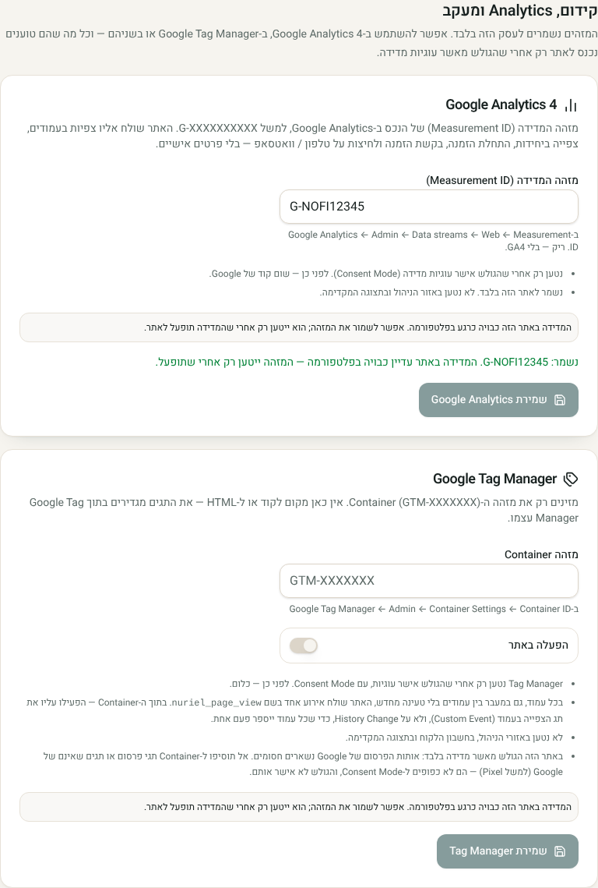

# קידום, Analytics ומעקב — מזהה GA4 ומזהה Tag Manager בהגדרות העסק

ניהול הצימר → **הגדרות העסק** → **קידום, Analytics ומעקב** (`/manage/settings#tracking`).

הכרטיסים מבוססים על שכבת המדידה הקיימת, `src/platform/analytics`, ואין מנגנון מדידה חדש:

- כרטיס GTM — היה קיים ונשאר.
- כרטיס GA4 — חדש, וחוזר על אותו מבנה.
- הטעינה באתר — המנגנון הקיים (`consent/ga.ts`, `gtm-client.ts`), אחרי הסכמה ועם Consent Mode.

## מה השתנה

|                     | לפני                                                                   | עכשיו                                                                                           |
| ------------------- | ---------------------------------------------------------------------- | ----------------------------------------------------------------------------------------------- |
| **איפה שומרים GA4** | בעורך האתר ← גוגל ושיתוף, בתוך טיוטת האתר. השדה הוצג רק כשהמדידה דלוקה | בהגדרות העסק, תמיד גלוי. נשמר מיד, בלי "פרסום"                                                  |
| **איפה נשמר**       | `document.seo.ga4` בגרסה המפורסמת                                      | `public.site_tracking.ga4_measurement_id` — שורה לכל עסק, לצד מזהה GTM (מיגרציה 199)            |
| **GTM**             | כרטיס בהגדרות                                                          | אותו כרטיס, בתוך הקטע החדש                                                                      |
| **מי משנה (צימר)**  | הבעלים, או מנהל/ת עסק                                                  | **בעל העסק או מנהל הפלטפורמה בלבד** (`hospitality.can('ownership')`). מנהל/ת עסק רואה הסבר בלבד |
| **עורך האתר**       | שדה GA4                                                                | הסבר וקישור לקטע החדש                                                                           |

**מזהה GA4 שכבר נשמר בעורך:** המיגרציה מעתיקה לטבלה מזהה GA4 מהגרסה המפורסמת האחרונה, ולא דורסת מזהה שכבר שמור בהגדרות. נבדק בבדיקת ה-Rollback.

## בדיקת תקינות

**GA4:** רק `G-` ואחריו 4 עד 16 אותיות באנגלית או ספרות.

- רווחים ואותיות קטנות מתוקנים לבד.
- ריק = הסרת המזהה.
- נבדק בארבעה מקומות: במסך, בשרת (`normalizeGa4Id`), בפונקציה במסד וב-`CHECK` בטבלה.

**GTM:** `GTM-` ואחריו 4 עד 12 תווים, כמו קודם.

**הודעות:**

- **שגיאה:** "מזהה Google Analytics 4 לא תקין — בתבנית G-XXXXXXXXXX". כפתור השמירה נעול.
- **הצלחה:** "נשמר: G-…". כשהמדידה כבויה בפלטפורמה, נוסף: "…המזהה ייטען רק אחרי שתופעל".
- **הסרה:** "המזהה הוסר".

## הפרדה בין עסקים

- **האתר שנשמר:** נקבע תמיד לפי הכתובת (Host) של הבקשה — `current_tenant_id()` — ולא לפי קלט מהדפדפן.
- **הטבלה:** סגורה ל-API, והגישה רק דרך פונקציות. `site_ga4()` מחזירה לאתר רק את המזהה שלו, ובצימר רק כשהמתג `hospitality_analytics_enabled` דולק לאתר.
- **יומן:** כל שינוי נרשם ב-`platform_audit_log` (`site_ga4_saved`) עם הערך הקודם ומי שינה.

## טעינה כפולה

כשמוגדרים גם GA4 וגם GTM:

- **GA4 ישיר:** האתר טוען `gtag.js` של המזהה פעם אחת בלבד.
- **אם `gtag.js` של אותו מזהה כבר בדף** (למשל נטען מתוך ה-Container): לא מוסיפים סקריפט שני. ההגדרות נכנסות ל-`dataLayer` המשותף.
- **צפיות בעמוד:** האתר שולח אותן ל-GA4 בעצמו, פעם אחת לכל עמוד.
- **אזהרה בכרטיס GTM:** לא להוסיף ב-Container תג GA4 לאותו נכס, כי אז כל צפייה תיספר פעמיים. את התוכן של ה-Container, שמוגדר בחשבון Google של בעל העסק, אנחנו לא יכולים לבדוק.

## בדיקות

| בדיקה                                                                                | תוצאה                                   |
| ------------------------------------------------------------------------------------ | --------------------------------------- |
| מסד: `site-ga4.test.sql` (חדש), `site-tag-manager.test.sql` (עודכן לכלל ההרשאה החדש) | כל חבילת המסד: 3410/3410, בשלושה מעברים |
| Rollback: הגנה, חזרה מדויקת לסכמה של 198, העתקה בהחלה מחדש                           | עבר — 284 בדיקות                        |
| יחידה וארכיטקטורה (כולל `tests/unit/site-ga4.test.ts` החדש)                          | 1313/1313                               |
| E2E: `tracking-settings.spec.ts` (חדש, 5)                                            | 5/5                                     |
| E2E: `site-consent.spec.ts`, `tag-manager.spec.ts` (עודכנו)                          | 22/22, מחשב וטלפון                      |
| E2E: הגדרות, Shabbat, מנהל/ת עסק, אינטגרציה                                          | 45 עברו, 1 מדולג                        |

מה מכסה `tracking-settings.spec.ts`:

- הקטע והסברים, ונגישות (axe).
- בדיקת תקינות והודעות.
- שמירה לעסק הזה בלבד.
- המזהה נשמר אחרי כניסה מחדש.
- צימר אחר לא רואה את המזהה, ומנהל/ת עסק לא יכול/ה לשנות.
- אחרי הסכמה: `gtag.js` אחד ו-`gtm.js` אחד, פרסום חסום, ואירועי `page_view` ו-`view_item` נשלחים.
- הסרת המזהה.

## לייצור (רק באישור)

אחרי פריסת הקוד ומיגרציה 199, בעל העסק (או מנהל הפלטפורמה) מזין את מזהה ה-GA4 בקטע החדש. המזהה נשמר, אבל **לא נטען באתר** עד שהמדידה תופעל לאתר בפלטפורמה — המתג `hospitality_analytics_enabled`, באישור נפרד.

לפני הפעלת המדידה:

- **מדיניות הפרטיות:** לעדכן את מדיניות הפרטיות של האתר.
- **הגדרות Google Analytics:** שמירת נתונים חודשיים, בלי Google Signals ובלי קישור לפרסום.

ראו `deploy-stage-3-4.md`, "הפעלת מדידה (GA4)".
