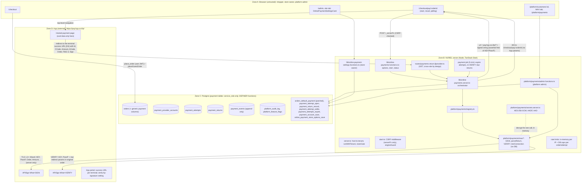

# MAX (Hyp Pay hosted page): payment-provider layer architecture

**Agent:** architecture. **Repo:** `(repo root)`, branch `payments/max-hyp` @ `910b1f9` (working tree clean, nothing modified).
**Method:** read-only code reading of the files cited plus `git show 9bbc37c^:…` (removed Hyp code); no tests run, no DB, no network to Hyp.

**Labels used**
- **(doc):** taken from the Hyp docs research file (`docs/payment-gateways/evidence/01-hyp-pay-official-docs.md`).
- **(unconfirmed):** not documented; this needs Hyp's answer.
- **(code-reading):** inferred from source and not executed.
- Every other claim about existing code cites `path:line`.

---

## 0. Key design decisions

1. **One generic order method value `'online'` plus a new `orders.payment_provider` column (`'max'`).**
   - Do not reuse `credit_card`. `scripts/db-tests/remove-hyp.test.sql:120-124,174-180` asserts that a `credit_card` request maps to `offline`.
   - With this value, a future provider needs no change to the CHECK, the trigger or the `place_order` mapping.
2. **The provider adapter is neutral and framework-free, under `src/platform/payments/`.**
   - It contains only pure protocol logic plus an injected `fetch`; it has no DB access.
   - The Ecommerce side (`src/lib/online-payments*.ts`) owns orchestration: DB, tenant and emails.
   - This is the split already planned for Grow (`docs/hospitality/payments-channels-plan.md:35-37`) and it respects `tests/architecture/boundaries.test.ts:85-131,133-170`.
3. **"Paid" is set by exactly one service_role-only DB function, `payment_attempt_settle`, and only after APISign `What=VERIFY` returns `CCode=0` (doc).**
   - VERIFY receives the raw redirect parameters in their original order (doc).
   - In the same transaction the DB checks: amount (integer agorot), currency, terminal, `Order`, and the **current** order amount due.
   - The browser redirect is only the carrier. It never sets "paid" by itself.
4. **Each return is its own row (`payment_returns`).**
   - A forged or garbled return can never change the attempt's state.
   - The same return arriving twice is deduplicated by digest.
   - A VERIFY that fails on transport (timeout or HTML) is retried by a job.
5. **No notify or webhook route in phase 1.** None is documented for Hyp Pay (doc). Phase 1 does not depend on one.
6. **Credentials: AES-256-GCM, with a key derived by HKDF from a new dedicated env secret.**
   - The AAD binds tenant + provider + mode + account + terminal, following the license pattern (`src/lib/license-crypto.server.ts:35-67`), not the Grow helper.
   - The platform admin writes them and they are never read back.
   - One terminal may belong to only one store (global UNIQUE).
7. **The tenant comes from the host at the return, and must equal the attempt's tenant.**
   - DB functions take an explicit `_tenant` and **never** rely on `current_tenant_id()`. That function falls back to the default tenant when no header is sent (`supabase/migrations/20261019260000_multi_store_members.sql:142-145`).
8. **The return route is a cross-site GET by design.** It carries no ambient authority, it is allowed through `storeGate` on locked stores, and it answers with a 303 to a clean result URL.
9. **Kill switches.**
   - Platform-wide: `platform_feature_flags` keys `online_payments_max` and `online_payments_max_live`.
   - Per store: `payment_provider_accounts.enabled` plus `mode`.
   - Turning a switch off stops **new** attempts only. Returns for attempts already redirected are still verified, because money may already have been taken.

---

## 1. Verified current state, and corrections to the inputs

| Topic | Fact (verified) | Evidence |
|---|---|---|
| Order creation | Logged-in customer: the browser calls the `place_order` RPC (SECURITY INVOKER). Guest: the server function `placeGuestOrder` calls `place_guest_order` (DEFINER, service_role only). The DB triggers set prices, total and VAT. | `supabase/migrations/20261019240000_offline_payments_bit.sql:252-338,341-418`; `src/routes/checkout.tsx:842-870,911-920`; `src/lib/checkout.functions.ts:99-163` |
| Payment request | `_details->>'payment_method'` is mapped inline (CASE in place_order / place_guest_order, string-patched). The trigger decides the final value. Staff orders and quotes are always `offline`. | `supabase/migrations/20261019520000_grow_payments.sql:188-205`; `supabase/migrations/20261019360000_remove_hyp.sql:46-91` (staff/quote at `:67-69`) |
| Amount | `order_amount_due(total, prices_include_vat, vat_rate)`; STORED `gross_amount`. | `offline_payments_bit.sql:423-433`; `supabase/migrations/20261115090000_vat_settings.sql:251-258` |
| Amount drift | A logged-in customer may insert `order_items` into their own `pending` order, and `awaiting` orders are `pending`. | `supabase/migrations/20260928090000_order_integrity.sql:151-157` |
| Payment guard | Payment columns revert to OLD unless `kobi.payment_update='on'`. An awaiting order can only become `pending` or `cancelled`. | `remove_hyp.sql:106-143` (Grow patch: `grow_payments.sql:172-186`) |
| Expiry | `expire_unpaid_orders()` every 5 min in every process. It is method-agnostic. | `remove_hyp.sql:179-200`; `src/server/services/payment-expiry.ts:14-29`; started at `src/server.ts:49` |
| Grow start | IP rate limit; order loaded through the scoped client; amount via RPC; success/cancel URLs from `tenantSiteOrigin()`; `notifyUrl` on the portal; old process superseded and new one inserted via `supabaseAdminUnscoped`. | `src/lib/grow-payments.functions.ts:34-36,47-69,78-91,93-110` |
| Grow paid | The webhook route (no CSRF, IP limit) calls `grow_mark_paid` (token hash, `statusCode='2'`, amount ±0.01 against the process row). Emails are sent inside `runWithTenant`; the paid-late bell rings store admins. There is no server-to-server re-check (finding S-2). | `src/routes/api.webhooks.grow.ts:13-31`; `src/lib/grow-webhook.server.ts:22-26,30-101,104-117,123-159`; `grow_payments.sql:213-278`; `docs/audit/SECURITY-FINDINGS.md:42-48` |
| Hard-wired methods | See the full list in §8.2. | |
| Reports | `store_analytics` counts revenue on `payment_status='paid'` (method-agnostic), so an `online` order counts with no change. | `supabase/migrations/20261019340000_store_analytics.sql:57,79,91` |
| Exports | **(code-reading)** No store-order CSV export exists. `src/lib/download-csv.ts` is imported only by product-import and Hospitality reports, so there is nothing to change. | `grep download-csv` |
| Host → tenant | `requestHost` → `resolveTenant` (`tenant_for_host`, 15 s cache) → `isUnknownStoreHost` → `runWithTenant` (AsyncLocalStorage) → `storeGate`. `currentTenantId()` fails closed. | `src/server.ts:150,181-199,222-226`; `src/integrations/supabase/tenant.server.ts:56-62,81-98,201-220,261-275` |
| Scoped client | `supabaseAdmin`: `select/update/delete` get `.eq(tenant_id)`; inserts are stamped; RPCs carry `x-tenant-id`. `supabaseAdminUnscoped` crosses tenants. | `src/integrations/supabase/client.server.ts:59-63,93-117,132-155` |
| RLS reality | RLS does **not** apply to service_role or table owners. In the server payment path, isolation comes from explicit tenant arguments, composite FKs and the proxy, not from RLS. `orders` has `UNIQUE(tenant_id,id)` for composite FKs. | `supabase/migrations/20261008090000_multi_tenant_foundation.sql:358-362,207,339-342` |
| Locked stores | `storeGate` returns 403 for every path except `SUSPENDED_ALLOWED_PATHS` and `/_serverFn`. On client navigation the root route redirects to `/locked`. | `src/server.ts:71-89`; `src/lib/blocked-pages.ts:30-31`; `src/routes/__root.tsx:124-125` |
| CSRF | `createCsrfMiddleware` is filtered to `handlerType==='serverFn'`. API and file routes are **not** covered. It allows `Sec-Fetch-Site: same-origin`, else Origin equal to the request origin, else a same-origin Referer; with no header at all the request is rejected. Auth uses a Bearer header, not cookies. | `src/start.ts:22-33`; `node_modules/@tanstack/start-client-core/dist/esm/createCsrfMiddleware.js:16-36` (react-start 1.168.60); `src/integrations/supabase/auth-middleware.ts:55-66` |
| Secrets today | **Grow:** AES-GCM with key = sha256(env), **no AAD, no HKDF**. **AI:** HKDF with a constant AAD, falling back to the service-role key. **Licenses:** HKDF with AAD = tenant + delivery, plus an HMAC fingerprint. `site_settings` is world-readable. | `src/lib/grow-crypto.server.ts:14-41`; `src/platform/ai/secrets.server.ts:14-63,65-75`; `src/lib/license-crypto.server.ts:35-74`; `supabase/migrations/20260907120000_b2b_beverage_platform.sql:454-464` |
| Platform-admin UI | Grow tab in the customer file. Inputs use `type=password` and `autocomplete=new-password` and are cleared after save. Badges show "configured ✓". Test button. Audit labels. Activity tab. | `src/components/platform/CustomerFile.tsx:90-111,185-187,278-280,287-300,828-1029` (`:873,923-925,999`) |
| Platform-admin server | `assertPlatformAdmin` (`is_platform_admin` RPC with the user token); `getGrowSettings` never selects `_enc` columns. | `src/lib/platform-grow.functions.ts:36-43,58-79` |
| Store-owner UI | Admin → "site" tab → `OfflinePaymentMethodsCard`, which writes `site_settings` straight from the browser. | `src/routes/admin.tsx:481-490`; `src/lib/site.ts:371-386` |
| Audit | `platform_audit_log`: UPDATE is blocked (DELETE is not); platform admins read it. `recordPlatformAudit` is **best-effort** (it swallows errors). `platform_set_flag` writes the audit row **inside the same transaction**. `license_audit` is a clean append-only pattern. | `supabase/migrations/20261019510000_platform_customer_files.sql:102-127,173-176`; `src/lib/platform-files.server.ts:36-59`; `supabase/migrations/20261101090000_platform_products_flags.sql:157-195`; `supabase/migrations/20261107100000_lic_digital_licenses.sql:146-179` |
| Rate limits | In-memory, per process, lost on restart; IP from `X-Real-IP`. A DB-backed limiter exists **only** in the `hospitality` schema. The order guard uses an advisory lock. | `src/lib/rate-limit.server.ts:1-8,26-55`; `src/platform/security/client-ip.ts:1-7`; `supabase/migrations/20261105130000_hosp_rate_check.sql:29-107`; `supabase/migrations/20261118110000_order_guard.sql:175-207` |
| Platform layer rules | `src/platform/**` may import only other platform modules plus a closed list of adapters. Platform server functions run on every host. The platform pattern uses `requireSession()` and `apiClient` with the user's token, or `serviceHeaders()` REST. | `tests/architecture/boundaries.test.ts:53-63,85-131,133-142`; `src/platform/engines/engine-guard.ts:19-31`; `src/platform/auth/session.server.ts:13-34`; `src/platform/supabase/api-client.server.ts:8-33`; `src/platform/supabase/env.server.ts:19-26` |
| Headers | CSP `form-action 'self'` (a form POST to Hyp would be blocked); `Permissions-Policy: payment=()`; `X-Frame-Options: SAMEORIGIN`. A redirect via `location.assign` works under these. | `src/lib/security-headers.ts:21-28` |

**Corrections to the inputs (precise):**
- **Codebase map, risk 10, "a customer can trigger confirmation emails before paying".** This is overstated. `prepareOrderEmail` returns `null` while `payment_status='awaiting'`, so `sendOrderEmails` sends nothing for unpaid orders (`src/lib/order-email-data.server.ts:95-104`; `src/lib/email.functions.ts:10-45`). The gate is method-agnostic, so MAX inherits it for free.
- **Lead's draft §6, "the existing DB rate limiting".** For stores, only the in-memory limiter exists (see the table above). Use DB caps per order and per attempt instead.
- **The removed Hyp code** sent VERIFY by GET with credentials in the URL. It also **silently stripped** reserved keys from the redirect instead of rejecting them (`git show 9bbc37c^:src/server/services/hyp.ts:161-189,309-338`). This design rejects such returns instead.

---

## 2. Architecture and trust boundaries



| Boundary | What crosses | Controls |
|---|---|---|
| A → B | Order id, method choice, return query string | All input is untrusted. Server functions are CSRF-checked (`src/start.ts:25-27`). The return route is cross-site with no authority attached (§5.4). |
| B → A | `{url}` (signed string), status DTOs | Assert that the SIGN response has no `KEY`/`PassP` and that the URL starts with the constant endpoint. No secrets or ciphertexts are ever returned. `*.functions.ts` files ship to the client, so they use dynamic server imports only (`src/integrations/supabase/client.server.ts:12-13`). |
| B → C | service_role RPC with explicit `_tenant` | Tables: `REVOKE ALL` from anon/authenticated, RLS + `tenant_isolation`. Paid is set only by `payment_attempt_settle` (service_role). |
| B → D | Credentials + order params | TLS 1.2+ (doc). POST body preferred; the docs say "most calls" accept POST, so **(unconfirmed)** for VERIFY. Never log URLs or bodies; Hyp asks to mask `KEY`/`PassP`/customer fields (doc). |
| D → B | SIGN/VERIFY responses (HTTP 200 even on error) | Parse `CCode`, not the HTTP status. An HTML body is a system error (doc). Cap response size; use timeouts. |
| A ↔ D | Card data | Only on the hosted page. No iframe in phase 1 (CSP `form-action`/`payment=()` above). Hyp's docs state that a hosted-page integration qualifies for **SAQ A** (doc). |

---

## 3. Provider layer

### 3.1 Layout
- **`src/platform/payments/` (platform layer, reusable later by Hospitality):**
  - `provider.ts`: types and money helpers (agorot).
  - `registry.ts`.
  - `secrets.server.ts`.
  - `http.server.ts`: form POST, timeout, size cap, HTML detection, redacting log.
  - `max/protocol.ts`: pure build/parse/classify.
  - `max/adapter.server.ts`.
  - `max/config.ts`.
  - `admin.functions.ts` / `admin.server.ts`: platform admin.
  - `db.server.ts`: service-role REST RPC with an explicit tenant, in the pattern of `src/platform/feature-flags/flags.server.ts:18-22`.
- **`src/lib/` (Ecommerce):**
  - `online-payments.ts`: browser-safe labels and types.
  - `online-payments.server.ts`: the orchestrator.
  - `online-payments.functions.ts`: checkout.
  - `online-payment-settings.functions.ts`: store owner.
  - `online-payment-jobs.server.ts`.
- **Routes and components:** listed in §8.

### 3.2 Interface (conceptual)
```ts
// src/platform/payments/provider.ts — pure types, no I/O, no framework imports
export type ProviderCode = "max";                          // extend per provider
export type Mode = "test" | "live";
export type Money = { minor: number; currency: "ILS" };    // integer agorot; never floats

export interface Capabilities {
  flow: "hosted_redirect";
  verify: "server_to_server_on_return";      // MAX: APISign What=VERIFY (doc)
  notify: "none" | "signed_webhook";         // MAX: "none" (not documented for Hyp Pay)
  inquiry: boolean;                          // MAX: false (not documented)
  returnUrl: "per_terminal_portal" | "per_request";   // MAX: per terminal (doc)
  installments: { maxGrantable: number; credit: boolean };  // Tash / tashType (doc)
  walletsToggle: "all_or_none" | "none";     // MAX: hideBtns=True (doc)
  currencies: readonly ("ILS")[];            // phase 1: Coin=1 (doc)
  refund: false; cancel: false; authorizeOnly: false;      // declared, disabled (zikoyAPI/CancelTrans/J5 later)
}

export interface ConfigSchema<S, P, G, O> {
  secrets: FieldSpec<S>[];   // write-only (MAX: KEY, PassP)
  publics: FieldSpec<P>[];   // MAX: terminalId (10 digits, doc); shown masked
  grants: FieldSpec<G>[];    // attested by platform admin from Hyp's terminal agreement
  options: FieldSpec<O>[];   // store owner, must be ⊆ grants
  validate(input: unknown): { secrets?: S; publics?: P; grants?: G; options?: O };
  clamp(grants: G, options: O): O;
}

export interface ProviderContext<S, P> { mode: Mode; publics: P; secrets: S; http: HttpClient } // secrets for one call

export interface StartRequest {
  ref: string;                 // attempt public_ref → Hyp `Order`
  amount: Money;               // from DB (payment_attempt_open), never from the browser
  description: string;         // `Info` (ASCII-safe until encoding is confirmed)
  maxInstallments: number;     // already clamped: grants ∩ options ∩ min-amount rule
  showWallets: boolean;        // false → hideBtns=True
  payer?: { firstName?: string; lastName?: string; email?: string; phone?: string };  // prefill (decision D9)
}
export type StartResult =
  | { ok: true; redirectUrl: string; digest: string }    // digest = sha256(signed string)
  | { ok: false; error: "credentials" | "rejected" | "unavailable" | "invalid_response"; code?: string };

export type ParsedReturn =
  | { ok: true; ref: string; approved: boolean; code: string; raw: string; digest: string;
      txnId?: string; amount?: Money; installments?: number; authCode?: string;
      cardLast4?: string; brandCode?: string; currencyCode?: string }
  | { ok: false; error: "malformed" | "reserved_key" | "duplicate_key" | "too_long" | "no_ref" | "no_sign" };

export type VerifyResult =
  | { kind: "authentic" }                               // VERIFY CCode=0 (doc)
  | { kind: "not_authentic"; code: string }             // e.g. 200 (doc)
  | { kind: "credentials"; code: string }               // 901/902/904 (doc) → our side
  | { kind: "transient"; reason: "timeout" | "network" | "html" | "http" };

export type Settlement =
  | { action: "settle"; txnId: string; amount: Money; installments: number; authCode?: string; cardLast4?: string; brandCode?: string }
  | { action: "review"; reason: string } | { action: "declined"; code: string }
  | { action: "retry" } | { action: "reject"; reason: string };

export interface PaymentProvider<S, P, G, O> {
  code: ProviderCode; label: string; capabilities: Capabilities; config: ConfigSchema<S, P, G, O>;
  start(ctx: ProviderContext<S, P>, req: StartRequest): Promise<StartResult>;
  parseReturn(rawQuery: string): ParsedReturn;                                   // pure
  verify(ctx: ProviderContext<S, P>, ret: Extract<ParsedReturn, { ok: true }>): Promise<VerifyResult>;
  mapStatus(ret: Extract<ParsedReturn, { ok: true }>, v: VerifyResult): Settlement;  // pure
  testConnection(ctx: ProviderContext<S, P>): Promise<{ ok: boolean; error?: string; code?: string }>;
  // refund/cancel deliberately absent; capabilities say false; no route, server fn or button exists
}
```

### 3.3 Registry and per-store selection
- **Registry:** `registry.ts` holds `const PROVIDERS = { max: maxProvider } as const`. `providerFor(code)` throws on an unknown code.
- **The DB decides which provider a store uses.** At most one `enabled` row in `payment_provider_accounts` per store (partial UNIQUE).
- **Availability:** `payment_online_available(_tenant, _uid)` returns `{account_id, provider, mode}` or NULL. It combines:
  - the platform flags (§9);
  - the account's `enabled` and `mode`;
  - the test-mode allow-list.
- **Callers:** the order trigger and `payment_attempt_open` use it. The orchestrator then uses `PROVIDERS[account.provider]`.
- **Adding a provider:**
  - an adapter folder;
  - a registry entry;
  - extend the `provider` CHECK in a migration;
  - the admin form, generated from `config`.
- **No change** is needed to checkout, orders, emails or the admin order panel.

### 3.4 How checkout and orders call it (no provider-specific code)
1. **Checkout options.** `getOnlinePaymentOptions()` returns `{available, label, brands, installments rule, testMode}` and nothing secret. The checkout shows one `online` option.
2. **Order creation.** The payload sends `payment_method:'online'`. The trigger stamps `payment_provider` from the account.
3. **Start.** `/checkout/pay/$orderId?start=1` calls `startOnlinePayment({orderId})`. The orchestrator opens an attempt, calls `adapter.start`, marks the attempt signed or failed, and returns `{url}`.
4. **Return.** `GET /payments/return/$provider`: `adapter.parseReturn` → `payment_return_record` → `adapter.verify` → `adapter.mapStatus` → `payment_attempt_settle` → emails/alerts → 303.
5. **Orders, emails and the admin panel** read the generic columns (`payment_provider`, `payment_reference`, …) and the provider label from `src/lib/online-payments.ts`.

### 3.5 MAX adapter: documented behaviour only
**SIGN request** (POST form to `https://pay.hyp.co.il/p/`; that endpoint is a constant):

| Parameter(s) | Status |
|---|---|
| `action=APISign`, `What=SIGN`, `Masof`, `KEY`, `PassP` | doc |
| `Order=<public_ref>` | doc |
| `Amount=<minor/100 formatted to 2 places>` | doc |
| `Sign=True`, `MoreData=True` | doc |
| `Coin=1` | doc, guide list only |
| `PageLang=HEB`, `Tash=<n>`, `FixTash=False`, `tashType` only if credit installments are granted | doc |
| `hideBtns=True` when wallets are off | doc |
| `ClientName`, `ClientLName`, `email`, `cell` | doc, only if decision D9 allows |
| `Info` | doc, guide list only |
| `UserId` | not sent (sensitive, doc) |
| `J5`, `Postpone`, `SendHesh`, `sendemail` | not sent |

**SIGN response validation:**
- The body must be URL-encoded text, not HTML (doc), and size-capped.
- It must contain `signature` and `action=pay` (doc).
- It must contain no `CCode` error (902/904, doc).
- It must contain **no `KEY`/`PassP` keys** (doc: "not echoed back"); if it does, abort.
- `Masof`, `Amount` and `Order` must echo our values (doc: "all parameters").
- Browser URL = constant + `?` + the raw response (doc).

**Return parsing (`parseReturn`):**
- Work on the raw query exactly as received. Never decode and re-encode it, because values may be Windows-1255 per the 3DS example (doc, encoding **unconfirmed**).
- **Reject** (do not strip) any case-insensitive duplicate key.
- **Reject** any reserved key we set ourselves on VERIFY (`action`, `What`, `Masof`, `KEY`, `PassP`); this blocks parameter pollution.
- Require exactly one `Sign` and one `Order`.
- Cap length (for example 4 KB).
- Parse only ASCII fields, with strict patterns:
  - `Id`: `^[0-9A-Za-z-]{1,40}$`.
  - `CCode`: `^\d{1,4}$`.
  - `Amount`: `^\d{1,9}(\.\d{1,2})?$` → agorot.
  - `Payments`, `L4digit` (4 digits), `Coin`, `ACode`, `Brand`.
- `digest = sha256(raw)`.

**VERIFY:** `action=APISign&What=VERIFY&Masof&KEY&PassP&` + the raw query unchanged (doc).

**Status mapping (pure):**

| Redirect `CCode` | VERIFY result | Settlement | Effect |
|---|---|---|---|
| `0` | authentic | `settle` (DB re-checks) | `paid`, `paid_late` or `needs_review` |
| `0` | not_authentic (e.g. `200`) | `reject` | event `verify_failed`; **attempt unchanged** |
| `0` | credentials (`901/902/904`) | `retry` | return stays pending; alert the platform admin |
| `0` | transient (timeout, HTML, network, HTTP) | `retry` | backoff; after N tries → `needs_review` |
| `600`/`700`/`800` | authentic | `review` | phase 1 never requests J2/J5/Postpone; nothing is charged (doc) |
| other non-zero | not called | `declined` | event; the attempt stays open (with only a success URL configured, Hyp shows declines on its own page; doc) |

**testConnection:** SIGN only, `Amount=1.00`, `Order=TEST<random>`. OK means `signature` is present and `Masof` matches. The URL is discarded, never opened and never charged; this is the old "free connection check" approach (commit `bf90e0f`, per the codebase map). Limit: 10 per hour per store.

---

## 4. Data model (conceptual; one new migration plus a rollback)

**`payment_provider_accounts`** (classified "platform", like `tenant_grow_credentials`).

| Column | Notes |
|---|---|
| `id` | |
| `tenant_id` | FK to `tenants`, CASCADE |
| `provider` | CHECK `IN ('max')` |
| `mode` | `test` or `live` |
| `enabled` | default `false` |
| `terminal_id` | CHECK `~ '^[0-9]{10}$'` (doc: 10 digits); not secret, because it appears in the signed URL |
| `secrets_enc` | `v1.` format: JSON `{KEY, PassP}`, AES-256-GCM |
| `key_version` | |
| `grants` | jsonb: max installments, credit installments, wallets, brands; plus `grants_verified_at`, `grants_verified_by` |
| `store_options` | jsonb: max installments, minimum amount for installments, show wallets |
| `test_user_ids` | `uuid[]` |
| `return_url_confirmed` | text, plus a checklist jsonb |
| `credentials_updated_at`, `credentials_updated_by` | |
| `last_test_at`, `last_test_ok`, `last_test_code` | |
| `last_verified_at` | |
| `updated_*` | |

Constraints on this table:
- `UNIQUE(tenant_id,id)` and `UNIQUE(tenant_id,provider,mode)`.
- **`UNIQUE(provider,terminal_id)`**: a terminal can belong to only one store.
- `UNIQUE(tenant_id) WHERE enabled`.

**`payment_attempts`.**

| Column | Notes |
|---|---|
| `id` | |
| `tenant_id` | |
| `order_id` | **FK `(tenant_id,order_id)` → `orders(tenant_id,id)`**, which exists at `multi_tenant_foundation.sql:207` |
| `account_id` | **FK `(tenant_id,account_id)` → accounts `(tenant_id,id)`** |
| `provider`, `mode`, `terminal_id` | snapshots |
| `public_ref` | UNIQUE, about 32 random alphanumerics: the `Order` |
| `amount_minor` | bigint, > 0 |
| `currency` | `='ILS'` |
| `max_installments` | |
| `status` | see §5 |
| `review_reason` | |
| `signed_digest` | |
| `created_at`, `redirected_at`, `settled_at`, `expires_at` | |
| `provider_txn_id`, `auth_code`, `card_last4`, `brand_code`, `installments` | |
| `review_handled_at`, `review_handled_by`, `review_note` | |

Indexes on this table:
- `UNIQUE(order_id) WHERE status IN ('created','redirected')`: one open attempt per order.
- `UNIQUE(order_id) WHERE status='paid'`: one paid attempt per order.
- `UNIQUE(provider,terminal_id,provider_txn_id) WHERE provider_txn_id IS NOT NULL`: a transaction can be used once.

**`payment_returns`.**

| Column | Notes |
|---|---|
| `id`, `tenant_id` | |
| `attempt_id` | composite FK |
| `digest` | `UNIQUE(attempt_id,digest)` |
| `return_enc` | encrypted raw query; AAD = tenant + attempt; purged when settled or after N days |
| `approved`, `code` | |
| `verify_state` | `pending`, `authentic`, `not_authentic`, `declined`, `transient` or `exhausted` |
| `verify_count`, `next_verify_at`, `lease_until` | |
| `received_at` | |

Limit: at most 20 returns per attempt.

**`payment_events`** (append-only, like `license_audit`):

| Column | Notes |
|---|---|
| `id`, `tenant_id` | |
| `attempt_id` | nullable, and deliberately **no FK**, so the record survives order deletion |
| `kind` | CHECK list |
| `detail` | jsonb, ≤ 2 KB, no PII or secrets |
| `created_at` | |

A BEFORE UPDATE OR DELETE trigger raises an exception. Rows are purged only by the tenant cascade.

**`orders` (new generic columns):**
- `payment_provider`, `payment_reference` (Hyp `Id`), `payment_auth_code`, `payment_card` (for example "••••1234"), `payment_installments`, `payment_live` (`false` = test-mode payment).
- CHECK: `(payment_method='online') = (payment_provider IS NOT NULL)`.
- CHECK: the other new columns are NULL unless the method is `online`.

**DEFINER functions** (`SET search_path`; explicit `_tenant`, validated against the row's `tenant_id`; `REVOKE ALL FROM PUBLIC, anon, authenticated` unless stated):

| Function | Grant | Purpose |
|---|---|---|
| `payment_online_available(_tenant,_uid)`, `payment_online_options(_tenant,_uid)` | service_role | used by the trigger and checkout |
| `payment_attempt_open(_tenant,_order,_uid)` | service_role | Locks the order `FOR UPDATE`. Requires `pending` + `online` + `awaiting` + matching provider. Caps: ≤ 10 attempts per order; ≥ 5 s since the last one. Computes `amount_minor` from `order_amount_due`. Clamps installments. Supersedes the open attempt. TTL 30 min. Sets `payment_due_at` = LEAST(created_at + 24 h, GREATEST(due, expires_at + 30 min)) under `kobi.payment_update`. |
| `payment_attempt_mark_signed` / `payment_attempt_mark_failed` | service_role | after SIGN |
| `payment_return_record(_tenant,_provider,_ref,_digest,_return_enc,_approved,_code)` | service_role | Looks up the attempt only for `_tenant`. If the ref exists for another tenant, it writes a `return_wrong_host` event and returns NULL; the caller learns nothing. Extends the order's due time when approved. |
| `payment_return_lease`, `payment_return_result` | service_role | VERIFY lease and outcome |
| `payment_attempt_settle(_tenant,_return,_txn,_amount_minor,_currency,_installments,_auth,_last4,_brand)` | service_role | Single transaction: `FOR UPDATE` on the attempt and the order. Checks tenant, provider and terminal; amount == attempt amount == **current** `order_amount_due`; currency; installments ≤ max; transaction id unused; no other paid attempt; order `awaiting`/`pending`. Sets `kobi.payment_update` and marks the order paid plus the generic columns. Results: `paid`, `already_paid`, `paid_late` or `needs_review(reason)`. |
| `payment_attempts_expire()`, `payment_returns_due(_limit)` | service_role | jobs (cross-tenant listing, justified) |
| `payment_account_save`, `…_set_enabled`, `…_save_grants`, `…_checklist`, `…_test_result`, `payment_account_status(_tenant)` | authenticated, gated by `is_platform_admin(auth.uid())` | each writes `platform_audit_log` **in the same transaction**, like `platform_set_flag` (`platform_products_flags.sql:190-193`) |
| `payment_account_secrets(_tenant,_provider,_mode)` | service_role only | ciphertext is never returned to `authenticated` |
| `online_payment_store_view()`, `online_payment_store_options_save(_options)` | authenticated, gated by `staff_can('admin')` | Use `current_tenant_id()`. This is safe for authenticated members, who get the header tenant only if they belong to it (`multi_store_members.sql:118-121`). Options are clamped to grants; the change is audited. |

**Patches to shared objects**, string-patched and failing loudly as in `grow_payments.sql:132-206`:
- `orders_payment_check`: add `'online'` and the new columns. Keep the **name** and keep `credit_card`.
- `orders_default_payment`:
  - reset the new columns;
  - add an `IF _requested='online'` branch: `payment_online_available` → `online` / `awaiting` / due in 2 h, else raise.
- `orders_payment_guard`: lock the new columns.
- `place_order` and `place_guest_order`: add `WHEN _details->>'payment_method'='online' THEN 'online'`.
- Add the ecommerce row guard to `payment_attempts`/`payment_returns` (`supabase/migrations/20261101100000_ecommerce_engine_guard.sql:85-110`).
- Seed `platform_feature_flags` rows, disabled.

**Grants on all new tables:**
- RLS enabled + `tenant_isolation` RESTRICTIVE.
- `REVOKE ALL FROM PUBLIC, anon, authenticated`; `GRANT ALL TO service_role`.
- This matches `grow_payments.sql:46-48,78-80` and satisfies `scripts/db-tests/tenant-isolation-coverage.test.sql:28-52`.

---

## 5. Attempt state machine and the phase-1 sequence

### 5.1 States

| State | Meaning | Entered by (only) | Next | Terminal |
|---|---|---|---|---|
| `created` | Amount and ref frozen; no Hyp page yet | `payment_attempt_open` (shopper holding the order capability, via `startOnlinePayment`) | `redirected`, `start_failed`, `superseded`, `expired` | no |
| `redirected` | SIGN succeeded; the browser has the URL | `…_mark_signed` (server) | `paid`, `paid_late`, `needs_review`, `superseded`, `expired`, `cancelled` | no |
| `start_failed` | SIGN refused, HTML or timeout | `…_mark_failed` (server) | none (a retry opens a new attempt) | **yes** |
| `superseded` / `expired` / `cancelled` | A newer attempt exists / TTL passed / order cancelled or expired | `…_open` / `payment_attempts_expire` (job) / settle (lazy) | `paid`, `paid_late`, `needs_review` (a VERIFY'd late return still settles, because money was taken) | soft |
| `paid` | VERIFY'd, every check passed; the order was marked paid in the **same transaction** | `payment_attempt_settle` (service_role) | none | **yes** |
| `paid_late` | VERIFY'd, but the order is no longer awaiting | settle | `review_handled_*` (a note only) | **yes** |
| `needs_review` | VERIFY'd but inconsistent, or VERIFY retries exhausted | settle / job | `review_handled_*` (note only; never "paid" in phase 1) | **yes** |

- **Return rows:** `pending` → `authentic` | `not_authentic` | `declined` | `transient` (back to `pending` via the job) | `exhausted`.
- **Order (`online`):**
  - `awaiting` → `paid`, by settle only.
  - `awaiting` → `expired`/`cancelled`, by the unchanged `expire_unpaid_orders`.
  - A staff cancel leaves `awaiting` in place (the existing guard does this); settle then returns `paid_late`.
- **Nothing callable from the browser can set "paid".**

### 5.2 Sequence
```mermaid
sequenceDiagram
  autonumber
  participant Br as Browser
  participant S as NURIEL server
  participant DB as Postgres
  participant H as Hyp (pay.hyp.co.il/p/)
  Br->>DB: place_order / placeGuestOrder, payment_method='online'
  DB-->>DB: triggers price, total and VAT; orders_default_payment → online/awaiting, due 2h; stock reserved
  Br->>S: POST /_serverFn startOnlinePayment({orderId}) [CSRF, engineGuard, requireStoreOpen, lock check, IP limit]
  S->>DB: payment_attempt_open(_tenant=host, _order, _uid)
  DB-->>S: attempt {ref, amount_minor (from DB), max_installments, account, terminal}
  S->>DB: payment_account_secrets(...) → decrypt (AAD) in memory
  S->>H: POST APISign What=SIGN (Masof, KEY, PassP, Order=ref, Amount, Coin=1, Sign=True, MoreData=True, Tash...)
  H-->>S: signed string (validate: not HTML, signature, echoes, no KEY/PassP)
  S->>DB: mark_signed(digest)
  S-->>Br: {url: "https://pay.hyp.co.il/p/?" + signed}
  Br->>H: top-level navigation; shopper pays (card data only at Hyp)
  H-->>Br: redirect to the terminal success URL (portal) with Id, CCode, Amount, ACode, Order, Fild1-3, Sign[...]
  Br->>S: GET /payments/return/max?... (store host)
  S->>DB: payment_return_record(_tenant=host, ref, digest, enc(raw)) [strict parse, IP limit]
  S->>H: POST APISign What=VERIFY (Masof, KEY, PassP + raw params, original order)
  H-->>S: CCode=0
  S->>DB: payment_attempt_settle(...) — one transaction: checks + order paid
  S-->>Br: 303 /checkout/pay/:orderId (Cache-Control: no-store, Referrer-Policy: no-referrer)
  S->>S: order emails (sendOrderEmailsInternal), bell on paid_late/needs_review
  Br->>S: poll getOnlinePaymentStatus (read-only; may lease one re-VERIFY of a pending return)
```

On a 302 versus `location.assign`: server functions are POST + JSON and CSRF-checked, so the "302 to Hyp" is a top-level navigation performed by the page with the URL the server returned. A true 302 would require a GET route with side effects, which this design avoids.

### 5.3 Edge cases

| Case | Handling |
|---|---|
| **Double click: checkout submit** | Two orders may be created (finding F18, no idempotency key). Only one gets paid; the other expires and releases stock. Optional idempotency key: decision D11. |
| **Double click: pay** | `payment_attempt_open` locks the order and supersedes the previous attempt; ≥ 5 s spacing; ≤ 10 attempts per order. If both Hyp pages get paid, the second settle finds a paid attempt → `needs_review` (duplicate) → bell → manual refund in the Hyp portal. |
| **Expired attempt** | The job sets `expired`. A later VERIFY'd return → `paid` if the order is still awaiting and the amounts match, else `paid_late`. A return extends the order's due time so verification retries are not cut off by order expiry. |
| **Return arrives twice** | `UNIQUE(attempt_id,digest)`. The lease prevents parallel VERIFY calls. If the attempt is already paid → idempotent 303. A different `Id` for the same attempt → VERIFY → `needs_review` (duplicate). |
| **Return on another store's host** | The lookup is by (host tenant, ref), so it is not found. A `return_wrong_host` event is written; no VERIFY is made with anyone's credentials; a generic page is shown. This catches portal misconfiguration. |
| **Paid but never returned** | Not detectable automatically: no notify or inquiry API is documented (doc). The attempt expires, the order expires, stock is released and the customer has been charged. See R1 and decision D7: a reconciliation list of "redirected, never returned" attempts showing their `Order` ref for lookup in the Hyp portal. |
| **Hyp timeout / HTML / network** | **SIGN:** one retry, then `start_failed`; the shopper sees "unavailable, try again"; the order stays awaiting. **VERIFY:** the return stays `pending`, the job uses backoff (1, 2, 5, 10, 30 min), a cap gives `needs_review` plus a bell. 902/904 are classified as "credentials" (alert the platform admin), not as forgery. |
| **Forged or garbled return** | Reserved or duplicate keys are rejected before any DB write. A VERIFY that fails → event only; the attempt stays as it was, so a genuine return still settles. An unknown `Order` → no VERIFY, which prevents us being used to amplify calls against Hyp. |
| **Amount drift** (customer adds items while awaiting; `order_integrity.sql:151-157`) | Settle compares against the **current** amount due → `needs_review`. Optionally block `order_items` changes while an `online` order is awaiting (decision D10). |
| **Store locked mid-payment** | The return path is added to `SUSPENDED_ALLOWED_PATHS` (`src/lib/blocked-pages.ts:30-31`). On a locked store the handler renders a minimal standalone result page, because the root route would redirect `/checkout/pay` to `/locked` (`src/routes/__root.tsx:124-125`). Start is refused when locked or during a rest window. |
| **Credentials replaced in flight** | `payment_account_save` refuses to replace the terminal or keys while returns are pending, unless forced; returns that can no longer be verified → `needs_review`. |

### 5.4 CSRF, replay and forged callbacks
- **Start, status and settings** are server functions, covered by `createCsrfMiddleware` (`src/start.ts:25-27`). Settings calls also carry a Bearer token, which is not a cookie.
- **The return route is cross-site by design.** It authorises nothing from cookies or the session. Its only state effects are:
  - a capped, encrypted return row;
  - a VERIFY-gated, idempotent settle.
- **Replay** is stopped by four controls:
  - `UNIQUE` on the provider transaction id per terminal;
  - one paid attempt per order;
  - digest dedupe;
  - per-attempt caps.
- **Cross-terminal signature replay** fails VERIFY because VERIFY runs with the attempt's own terminal credentials. This assumes `Sign` is bound to the terminal **(unconfirmed; Hyp question Q5)**.

---

## 6. Tenant isolation at every layer

| Layer | Control | Evidence / new |
|---|---|---|
| Host → tenant | `tenant_for_host` plus `isUnknownStoreHost` (404); nginx overwrites `X-Forwarded-Host` and `X-Real-IP`; the app port is only `expose`d, not published | `src/server.ts:181-199`; `deploy/nginx/nuriel-shop.nuri1.fit.conf:22-25,36-41`; `docker-compose.yml:28-29` (code-reading) |
| Request context | `runWithTenant` (ALS); `currentTenantId()` fails closed | `tenant.server.ts:201-220` |
| Start | Order loaded through the scoped `supabaseAdmin`. `payment_attempt_open(_tenant=currentTenantId())` re-checks `o.tenant_id`. Composite FKs to the order and the account. | new; FK basis `multi_tenant_foundation.sql:207` |
| Credentials | Loaded only by `(attempt.tenant_id, provider, mode)`. AAD `payments:v1:<tenant>:<provider>:<mode>:<account>:<terminal>`: a ciphertext copied into another store's row fails to decrypt. `UNIQUE(provider,terminal_id)`. | pattern: `license-crypto.server.ts:43-66` |
| Return | (host tenant, ref) must match; otherwise no VERIFY. Correctness does not depend on the host: even a spoofed host could only settle that host's own attempts, and only with Hyp's VERIFY. | new |
| DB functions | Explicit `_tenant` everywhere; never `current_tenant_id()` in service-role functions (default-tenant fallback, `multi_store_members.sql:142-145`). **(code-reading)** The default tenant is `…0001` (`multi_tenant_foundation.sql:61-66`); if that is Nuriel Computers, an unscoped mistake would hit the live phase-1 store. | new |
| RLS | Enabled on every new table, `tenant_isolation` RESTRICTIVE, no anon/authenticated grants. This is defense in depth only, because service_role bypasses RLS. | `multi_tenant_foundation.sql:358-380`; coverage test |
| Cross-tenant clients | `supabaseAdminUnscoped` appears only in the jobs (listing due attempts/returns). Each item is then processed inside `runWithTenant` with its own tenant, as Grow does for emails (`grow-webhook.server.ts:104-117`). Platform-admin functions pass `_tenant` explicitly to platform-admin-gated DEFINER functions. Grow's unscoped writes (`grow-payments.functions.ts:94-106`) are **not** copied. | new |
| Emails and bells | Run in the attempt's tenant context; bell targets come from `user_roles` of that tenant | `grow-webhook.server.ts:123-159` pattern |
| Refunds (later) | `payment_refunds` with composite FK `(tenant_id, attempt_id)`, using only the attempt's account | declared, disabled |

---

## 7. Admin screens

### 7.1 Platform admin
| Need | Existing pattern to reuse | New |
|---|---|---|
| Per-store enable/disable, mode (test/live) | Grow tab "enabled" checkbox and audit (`CustomerFile.tsx:946-953`; `platform-grow.functions.ts:154-175`) | `src/components/platform/MaxPaymentsTab.tsx`, a new `TabsTrigger value="max"` next to `grow` (`CustomerFile.tsx:185-187,278-280`); `payment_account_set_enabled` (audited in the same transaction) |
| Terminal + KEY + PassP entry, write-only | `type=password`, `autocomplete=new-password`, cleared after save, placeholder "saved — retype to replace" (`CustomerFile.tsx:873,913-933`); only non-secret columns selected (`platform-grow.functions.ts:64-69`) | The server function encrypts (`secrets.server.ts`) and calls `payment_account_save`. KEY/PassP are never returned. The terminal is shown masked (••••1234). Field pattern: printable ASCII without spaces, because Hyp's formats are **(unconfirmed)** (Grow uses `^[A-Za-z0-9_\-.]{4,120}$`, `platform-grow.functions.ts:46-56`). |
| Test connection | `testGrowConnection` (`platform-grow.functions.ts:198-237`) | SIGN-only test; result stored in `last_test_*`; audited; 10 per hour |
| Terminal status | Badges (`CustomerFile.tsx:898-912`) | Configured; enabled; mode; last test (code); last verified payment; open attempts; pending returns; `needs_review` count; **success URL to paste into the Hyp portal** (computed, with a copy button); checklist: "verify-by-signature on", "success URL set", "error URL not set" (each confirmed by/at) |
| Credentials last-updated | `updatedAt` (`CustomerFile.tsx:907-911`) | `credentials_updated_at/by` |
| Grants ("what Hyp granted") | — | Max installments, credit installments, wallets, brands; `grants_verified_at/by` (Hyp has no documented terminal-capability API) |
| Change log with actor | Activity tab with `actor_email` (`CustomerFile.tsx:287-300`); `AUDIT_LABELS` (`:90-111`) | Add `payment_*` labels; a filtered list in the tab |
| Global switches, store overview | `PlatformShell` nav (`src/components/platform/PlatformShell.tsx:29,57-111`); `platform_set_flag` (audited) | `src/routes/platform_.payments.tsx`: the two flags and a stores table |

### 7.2 Store owner (no secrets)
| Need | Existing pattern | New |
|---|---|---|
| Payment status | `OfflinePaymentMethodsCard` in the admin "site" tab (`src/routes/admin.tsx:481-490`) | `src/components/payments/OnlinePaymentSettingsCard.tsx`: "active (live)", "test mode", or "disabled by platform"; terminal ••••1234; last verified payment |
| Max installments; minimum amount for installments | Grow's 1–12 select (`CustomerFile.tsx:955-969`) | Options clamped to grants by `online_payment_store_options_save` (DEFINER, `staff_can('admin')`, audited). **Never** written to `site_settings`, which is world-readable. |
| Methods and brands shown only if verified | — | Logos and the wallet toggle come only from `grants`; wallets only in live mode (wallets and bit work only in production, doc) |
| Attention list | Paid-late bell (`grow-webhook.server.ts:123-159`) | `paid_late` / `needs_review` attempts with the Hyp `Id`, plus "mark handled" with a note (audited). No refund button. |
| Order card | `GrowPaymentInfo` (`OrderManagementPanel.tsx:783`) | `src/components/orders/OnlinePaymentInfo.tsx`: reference, auth code, card, installments, TEST badge |

---

## 8. Files

### 8.1 New files
| Path | Purpose |
|---|---|
| `supabase/migrations/20261128100000_online_payments_max.sql` | Tables, indexes, DEFINER functions, grants/RLS, shared-object patches, flag seeds, engine guard |
| `supabase/rollbacks/20261128100000_online_payments_max.down.sql` | Reverses everything, with a `DO … RAISE EXCEPTION` data guard if attempts or accounts exist (`tests/architecture/rollback-guards.test.ts:1-3,52-59`) |
| `scripts/db-tests/online-payments.test.sql` | Grants, isolation, state machine, settle checks, `remove-hyp` invariants |
| `scripts/db-tests/online-payments-concurrency.sh` | Parallel settle / return / start (pattern: `order-guard-concurrency.sh`) |
| `src/platform/payments/provider.ts` | Interface, capabilities, money (agorot) |
| `src/platform/payments/registry.ts` | `PROVIDERS` map |
| `src/platform/payments/secrets.server.ts` | AES-256-GCM, HKDF, AAD, `v1.`, key version |
| `src/platform/payments/http.server.ts` | POST form, timeout, size cap, HTML detection, redacting log |
| `src/platform/payments/db.server.ts` | Service-role REST RPC with explicit tenant |
| `src/platform/payments/max/protocol.ts` | Pure SIGN/VERIFY builders, response and return parsers, CCode classes |
| `src/platform/payments/max/adapter.server.ts` | `PaymentProvider` for MAX |
| `src/platform/payments/max/config.ts` | Secrets, publics, grants and options schemas |
| `src/platform/payments/admin.functions.ts` / `admin.server.ts` | Platform-admin server functions (status, save, enable, grants, checklist, test, log) |
| `src/lib/online-payments.ts` | Browser-safe types and labels (`online`, provider labels) |
| `src/lib/online-payments.server.ts` | Orchestrator: open, sign, record return, verify, settle, emails, alerts |
| `src/lib/online-payments.functions.ts` | `getOnlinePaymentOptions`, `startOnlinePayment`, `getOnlinePaymentStatus` |
| `src/lib/online-payment-settings.functions.ts` | Store-owner view and save |
| `src/lib/online-payment-jobs.server.ts` | Expire attempts, re-VERIFY due returns, purge `return_enc` |
| `src/routes/payments.return.$provider.ts` | GET return handler, 303, `no-store`, `no-referrer` |
| `src/routes/checkout_.pay.$orderId.tsx` | Start / result / poll route |
| `src/components/checkout/OnlinePaymentPage.tsx` | Stages modelled on `GrowPaymentPage.tsx` |
| `src/components/orders/OnlinePaymentInfo.tsx` | Admin order card |
| `src/components/payments/OnlinePaymentSettingsCard.tsx` | Store-owner card |
| `src/components/platform/MaxPaymentsTab.tsx` | Platform-admin per-store tab |
| `src/routes/platform_.payments.tsx` | Global switches and store overview |
| `tests/unit/max-protocol.test.ts` | Parsers: raw preservation, Windows-1255 bytes, reserved/duplicate keys, HTML |
| `tests/unit/payment-secrets.test.ts` | AAD binding; wrong tenant fails |
| `tests/unit/online-payments-orchestrator.test.ts` | Mocked fetch: success, decline, 902, timeout, HTML, replay |
| `e2e/tests/online-payment-max.spec.ts` | End to end against the Hyp mock |
| `src/routes/api.webhooks.payments.$provider.ts` | **Only if** Hyp documents a notify mechanism; it must route into the same VERIFY + settle path |

### 8.2 Changes to existing files (Grow, bit, offline and POS behaviour unchanged)
| Path:line | Change | Why |
|---|---|---|
| `src/lib/checkout.ts:157` | Add `"online"` to `PaymentMethodChoice` | Method value |
| `src/lib/checkout.functions.ts:49-51,134-162` | Map `online` in `cleanPayload`; add an `online` flag (skip emails, like grow) | Guest path |
| `src/routes/checkout.tsx:236-243,336-349,783,816-870,911-920,1465-1560,1662-1688` | Load options; new radio; navigate to `/checkout/pay/$orderId?start=1`; button texts | UI switch |
| `src/lib/bit-payments.ts:17,26-31,37-62` | `PaymentMethod` + label + paid label for `online` | Badge and labels |
| `src/lib/orders.ts:313-327,331-341` | Type union + generic columns in `ORDER_SELECT_COLUMNS` | Admin and customer screens |
| `src/components/OrderManagementPanel.tsx:35-36,776-784` | Render `OnlinePaymentInfo` | Admin |
| `src/lib/order-email-data.server.ts:96-104,288-295` | Select the generic columns | Emails |
| `src/lib/order-emails.server.ts:82-98` | New `online` branch (staff) | Emails |
| `src/server/services/notifications.ts:396-412` | New `online` branch (customer) | Emails |
| `src/server/services/payment-expiry.ts:14-29` | Also run the online jobs | Expiry and re-VERIFY |
| `src/lib/blocked-pages.ts:30-31` | Add `payments` to `SUSPENDED_ALLOWED_PATHS` | Returns on locked stores |
| `src/platform/analytics/gtm.ts:91-97` | Add `/checkout/pay/:id` to `PERSONAL_PATHS` | No order id sent to GA/GTM |
| `src/lib/marketing.ts:197` (`NO_MARKETING_PATHS`) | Decide whether the redirect step runs without store tags | R6 |
| `src/components/platform/CustomerFile.tsx:90-111,171-197` | Audit labels; MAX tab | Platform admin |
| `src/components/platform/PlatformShell.tsx:29,57-111` | Payments nav item | Platform admin |
| `src/routes/admin.tsx:490` | Render `OnlinePaymentSettingsCard` | Store owner |
| `src/integrations/supabase/types.ts` | Regenerate | New tables and functions |
| `docker-compose.yml:51-53`, `.env.example`, `deploy/setup-selfhost.sh:117-127` | New `PAYMENTS_SECRETS_KEY` (≥ 32 chars, generated once, never overwritten) | `tests/unit/env-forwarding.test.ts:34-46` |
| `tests/unit/env-forwarding.test.ts:15-20` | Add `MAX_PAY_TEST_URL` to `TEST_ONLY` | Mock hook, never in production |
| `e2e/scripts/mock-services.mjs:170-226`, `e2e/scripts/app-up.sh:23` | Hyp mock (SIGN, pay-redirect, VERIFY, HTML, 902, delay) | E2E |
| `deploy/nginx/nuriel-shop.nuri1.fit.conf:31-41` | `location ^~ /payments/return/` with `access_log off` (or a format without `$args`) | The query carries name, email and L4digit; Hyp says to mask (doc) |
| `scripts/db-classification.mjs:33-49` (+ regenerate `scripts/db-tests/db-classification.test.sql`, `docs/architecture/db-classification.md`) | Classify the new tables and functions | Coverage test |
| `scripts/db-tests/ecommerce-engine-guard.test.sql:39-53` | List and count (40 → 42) | Engine guard |
| `scripts/db-tests/rollback-check.sh:~201` | Add `M92=…online_payments_max` | `tests/architecture/migrations.test.ts` |

**Unchanged** (explicitly):
- Grow: `src/lib/grow*.ts`, `src/lib/platform-grow.functions.ts`, `src/routes/api.webhooks.grow.ts`, `src/routes/checkout_.grow.$orderId.tsx`, `GrowPaymentPage.tsx`, `GrowPaymentInfo.tsx`, `tenant_grow_credentials`, `grow_payment_processes`, `grow_mark_paid`.
- Bit: all `bit_*` objects.
- Shared: `expire_unpaid_orders` (body unchanged), `site_settings_payment_methods_guard`, POS.

### 8.3 `scripts/db-tests/remove-hyp.test.sql`: how the design complies (no assertion change needed)
| Assertion (line) | Rule | Design |
|---|---|---|
| `:42-44` | No `payment_intents`, `tenant_payment_secrets`, `platform_settings` tables | Tables: `payment_provider_accounts/attempts/returns/events` ✓ |
| `:45-49` | No public column `LIKE 'hyp\_%'`, `payment_token`, `card_payments_enabled`, `card_clearing_live` | Columns: `terminal_id`, `secrets_enc`, `public_ref`, `payment_provider`, `payment_reference`, … ✓ |
| `:50-59` | 22 removed function names must not return | Avoid the natural names `store_payment_settings`, `store_save_payment_settings`, `platform_payment_settings`, `card_payments_active`, `order_payment_intent`. Use `online_payment_store_*`, `payment_online_available`, `payment_attempt_*` ✓ |
| `:60-63` | **No public function body (`prosrc`, so comments and string literals count) matches** `(hyp_\|payment_intent\|tenant_payment_secrets\|platform_settings\|card_payments_\|card_clearing\|platform_payments_\|checkout_payment_request\|payment_token)` (case-insensitive) | Rules for **every** new or patched body: no `hyp_` anywhere (event kinds, comments, error codes: use `max_`/neutral); no "payment intent"; flag keys must not start with `platform_payments_`; no `payment_token` variables ✓ |
| `:74-84` | `orders_default_payment` immediately after `orders_assign_number` and immediately before `orders_enforce_kind` among BEFORE INSERT row triggers | No new BEFORE INSERT trigger on `orders` (patch the existing function). Any future one must sort after `orders_enforce_kind`. AFTER triggers are unaffected ✓ |
| `:85-88` | `orders_payment_check` and `billing_history_payment_method_check` both contain `credit_card` (count = 2) | Recreate `orders_payment_check` with the **same name**, keeping `credit_card` ✓ |
| `:89-92` | `place_order`/`place_guest_order` contain `_details ->> 'payment_method' = 'bit'`; exactly 2 functions | Add a `WHEN … 'online'` clause; **no overloads** (an idempotency-key overload would fail `count(*)=2`) ✓ |
| `:120-124,174-180` | `credit_card` request → `offline` | New value `online`. Reusing `credit_card` for MAX would break these and **would need the owner's approval** (not recommended) |
| `:227-232` | No `payments_ready` in `store_billing`/`addons_store` | Platform billing untouched ✓ |

---

## 9. Feature flags and kill switches

| Switch | Scope | Mechanism | Who | New attempts | In-flight returns |
|---|---|---|---|---|---|
| `online_payments_max` | Platform-wide master | `platform_feature_flags` row (key format `platform_products_flags.sql:115-118`), set via `platform_set_flag` (audited, `:157-195`) | Platform admin | Blocked (UI hidden; `orders_default_payment` and `payment_attempt_open` re-check in SQL) | **Still verified and settled** |
| `online_payments_max_live` | Platform-wide live gate | Same | Platform admin | Live accounts blocked; test accounts still work | Still processed |
| `payment_provider_accounts.enabled` | Per store | DEFINER save, audited | Platform admin | Blocked for that store | Still processed (credentials kept) |
| `mode` test/live | Per account (one enabled account per store) | Same | Platform admin | `test`: option visible and accepted only for `test_user_ids`. Staff orders are forced offline (`remove_hyp.sql:67-69`), so testers must be non-staff accounts; prefer staging (`deploy/staging`). The paid order carries `payment_live=false` and a TEST badge. | n/a |
| Optional "settlement hold" | Platform-wide incident brake | Third flag | Platform admin | n/a | Recorded and verified but **not** settled; queued for review |

Notes:
- Read the platform rows directly through a small DEFINER function. `platform_feature_enabled()` ANDs a tenant row (`:139-150`), which would create a second per-store switch.
- The TypeScript flag cache is 15 s and fails closed (`src/platform/feature-flags/flags.server.ts:1-29`). The SQL re-check is authoritative.

---

## 10. Risks, unknowns, owner decisions

### 10.1 Risks
| ID | Risk | Severity | Mitigation | Depends on Hyp |
|---|---|---|---|---|
| R1 | Paid but never returned: the customer is charged, the order expires and stock is released. No notify or inquiry exists for Hyp Pay (doc). The removed code assumed a portal "server-to-server notification" setting (`git show 9bbc37c^:src/server/services/hyp.ts:15-17,33`). | High | Ask Hyp. Reconciliation list (redirected, never returned). Hold extensions. Daily check against the Hyp portal in the pilot. | Q2, Q3 |
| R2 | VERIFY may not cover `Order`/`Amount`/`CCode`/`Id`. If it does not, a cheap genuine transaction could be re-targeted at another attempt. | High | Exact amount vs attempt **and** the current order amount; unique transaction id; one paid attempt; pilot reconciliation | Q4, Q5 |
| R3 | Encoding and "original order": any decode/re-encode (by our code, or by the 308/301 redirects `src/server.ts:154-155,184-193`) can break VERIFY | Medium | Forward raw; never re-serialize; sandbox test with Hebrew `Fild1` | Q6 |
| R4 | Success URL is a manual per-terminal portal setting: misroutes, or stale after a domain change | Medium | Recommend the platform subdomain (`slugOriginForTenant`, `tenant.server.ts:326-338`), which stays stable when custom domains change; misroute event; checklist | Q15 |
| R5 | Amount drift via customer item inserts (`order_integrity.sql:151-157`) | Medium | Settle compares the current amount due; optional lock (D10) | — |
| R6 | Store-controlled GTM or pixel scripts on the checkout page could tamper with the redirect URL (phishing) | Medium | Perform the redirect on a page without third-party tags (`NO_MARKETING_PATHS`, `src/lib/marketing.ts:197`); confirm SAQ A eligibility with the acquirer | — |
| R7 | Test and live confusion | Medium | Explicit mode; allow-list; `payment_live` marker; the `00100` terminal prefix used only as a warning (rule **unconfirmed**, doc Q10) | Q10 |
| R8 | Rate limits are per process and lost on restart | Low–Medium | DB caps per order, attempt and return are the real bounds | — |
| R9 | Key management: losing the key forces credential re-entry. Backups put the DB and `.env` in one age-encrypted archive (`deploy/backup-daily.sh:225-235`). | Low–Medium | Dedicated key; `key_version` rotation; never fall back to the service-role key (unlike AI, `src/platform/ai/secrets.server.ts:72-74`) | — |
| R10 | String-patching shared trigger functions (already patched 2–3 times) is fragile | Medium | Patch with loud failure; keep `grow-payments`, `remove-hyp` and the new tests green; read the live definitions from a built DB | — |
| R11 | Duplicate orders from double submit (F18) | Low | Busy flag exists; optional idempotency key without overloading `place_order` | — |
| R12 | PII in logs: nginx access log and return URL; `recordPlatformAudit` is best-effort | Medium | nginx change; 303 to a clean URL; audit written inside the DB transaction | — |

### 10.2 Owner decisions
| # | Decision | Recommendation |
|---|---|---|
| D1 | Method value | `online` + `payment_provider`; alternative `max` |
| D2 | Who enters credentials | Platform admin only (Grow precedent). The lead's phase 6 (store owner enters credentials) conflicts with the screen split in the task. |
| D3 | Encryption key | New `PAYMENTS_SECRETS_KEY`; alternative: HKDF label derived from `GROW_SECRETS_KEY` |
| D4 | Configured return host | Platform subdomain, not the custom domain |
| D5 | Windows | Attempt TTL 30 min; order hold 2 h; +2 h on an approved return; cap 24 h |
| D6 | Late payment | `paid_late` + bell, no reopen (Grow, `grow_payments.sql:252-259`); alternative: reopen (Hyp era) |
| D7 | Never-returned payments | Reconciliation list. Any manual "confirmed in the Hyp portal" path would be an explicit manual exception to the rule "paid only after server verification". |
| D8 | Testing | Staging tenant first; on the live store only allow-listed non-staff accounts |
| D9 | Prefill | Name, email, phone; never `UserId` (doc: sensitive) |
| D10 | Order items while awaiting | Block item changes while an `online` order is awaiting |
| D11 | Checkout idempotency key | Optional, without overloading `place_order` |
| D12 | Card-only store | Keep phone/Bit required (`remove_hyp.sql:209-234` guard) in phase 1 |
| D13 | `needs_review` | Store owner handles it (note only); refunds in the Hyp portal |
| D14 | Capability for `/checkout/pay/<orderId>` | The order UUID, as Bit and Grow use today; a stronger per-order key is possible |
| D15 | Store-option permission | `staff_can('admin')` vs `billing.manage` |
| D16 | Terminal uniqueness | Global unique in test mode too? |
| D17 | MoreData | `MoreData=True`; encrypted raw-return retention ≤ 7 days |

### 10.3 Questions for Hyp, in blocking order
1. Q2: Is there a notify mechanism, including the portal setting?
2. Q3: Is there a transaction inquiry API?
3. Q5: Which fields does `Sign` cover, and is it bound to the terminal?
4. Q4: What does VERIFY return for declines and for 600/700/800?
5. Q6: What is the encoding, and must the raw values be forwarded?
6. **New:** maximum length and charset of `Order`; whether POST is accepted for SIGN and VERIFY; lifetime of a signed page; whether the success URL is hit for wallet/bit payments too.
7. Q8: Are `Amount` and `Sign` mandatory?
8. Q7: Are `Coin`, `Info` and UTF-8 accepted on APISign?
9. Q12: What do the `Brand` codes mean?
10. Q11: Are there IP allow-lists?
11. Q16: Does Hyp deduplicate by `Order`?
12. Q15: Can the URL be set per request? (Question numbers refer to the research file.)

---

## 11. Critique of the lead's drafts (proposed edits)

**§3 (flow):**
- **Diagram step 5א (notify).** Remove it from phase 1: not documented for Hyp Pay (doc).
- **Step 5ב, "browser return: only records".** The return **triggers** APISign VERIFY server-to-server. That is the official and only mechanism. "Paid" equals VERIFY plus the DB checks, never the browser parameters.
- **Table row 3 (local HMAC if official).** Drop it. Local HMAC exists only in third-party plugin code; the docs say "you just send the parameters … back to us".
- **Row 1, "credit card".** It is a label only. The stored value must be new (`online`); `credit_card` → `offline` is asserted (`remove-hyp.test.sql:120-124`).
- **Row 2 TTL.** Add the extension of `payment_due_at` on start and on return, with a cap. Grow does not extend it (`grow-payments.functions.ts:93-111`).
- **Row 6.** A VERIFY **failure** is a logged event and must not move the attempt to `needs_review`, because a forger could otherwise freeze genuine payments. Only authentic-but-inconsistent → `needs_review`.

**§3 tenant paragraph:**
- Add the recommended return host (D4).
- Add the `storeGate` handling (`blocked-pages.ts:30-31`).
- Add AAD binding and the global unique terminal.

**§6 (security):**
- **"Forged callback" row.** Replace "(1) Sign HMAC, constant-time" with "APISign VERIFY with raw params in original order; reject reserved/duplicate keys". Replace (3) with "no documented notify/inquiry".
- **"Amount" row.** Add "equal to the **current** amount due at settle time".
- **"Flooding" row.** Use DB caps, not "existing DB limiter".
- **"Logs" row.** Add the nginx access log and the 303 to a clean URL.
- **"Test mode" row.** Staff orders are forced offline, so testers must be non-staff accounts or staging.
- **Add rows:**
  - CSRF (server functions are covered; the return route has no ambient authority);
  - third-party scripts on checkout (R6);
  - HTTP 200 on error and HTML responses;
  - locked store.

**§7 (tests):**
- 7.1 "signature vectors" becomes: SIGN request building, SIGN response validation (no KEY/PassP, echoes), return parsing (raw, Windows-1255, reserved/duplicate keys), VERIFY classification (0, 200, 902, HTML, timeout).
- Add: `remove-hyp`, `grow-payments`, tenant-coverage, engine-guard, env-forwarding and boundaries all stay green.
- 7.2 item 6 (notify): N/A. Replace it with "return opened twice / in two tabs".
- Add: "tab closed before the redirect" (shows R1); "success URL pointing at another store" (misroute event); Hebrew `Info`/`Fild1` still gives VERIFY `CCode=0`; installments above the grant give 903 or `needs_review`.

**§8 (phases):**
- **Phase 3.** "Allow-list per store" should be implemented as `account.enabled` plus the flags, not a hard-coded tenant.
- **Phase 5.** Add the Hyp-portal checklist, the nginx log change and key generation.
- **Phase 6.** It conflicts with D2.
- **Phase 1 DB names are compliant**, but the `prosrc` regex (§8.3) binds every new function body.
