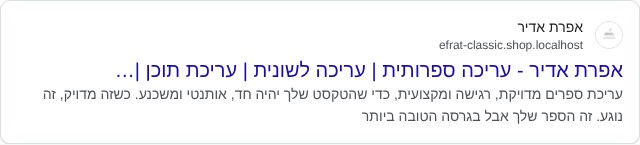
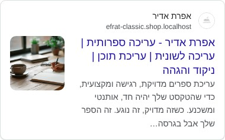

# האתר של אפרת אדיר ↔ ניהול הפלטפורמה של Nuriel — דוח בדיקה והשלמה (לפני פריסה)

ענף: `websites/engine` · תאריך: 16.11.2026 · **לא בוצעו פריסה, Merge, פרסום, שינוי DNS, או כל פעולה בייצור.**
כל מה שמתואר כאן נבנה ונבדק בסביבת הבדיקה המקומית (מסד בדיקה, שירות מיילים מדומה, DNS מדומה בשמות `.test`).
אתר ה-Preview נשאר חסום לגוגל (`noindex` + `robots.txt` סגור) — לא הוסר.

---

## תשובות קצרות ל-10 השאלות

| # | שאלה | תשובה |
| --- | --- | --- |
| 1 | האם האתר של אפרת מקושר לניהול הפלטפורמה? | **כן.** בפאנל: "אתרי אינטרנט" → "תיק האתר" של אפרת — כתובת, מצב, תבנית, דומיין, תאריכי עדכון ופרסום, יומן פעולות, וכפתורי "כניסה לניהול האתר" / "תצוגה מקדימה" / "עריכת תוכן" / "כתובת ודומיין" / "בדיקת בקשת פרסום". |
| 2 | אפשר לנהל אותו בלי החשבון של אפרת? | **כן**, בהרשאות מנהל הפלטפורמה הקיימות: קוד כניסה חד-פעמי (2 דקות, קשור לאתר הזה בלבד), בלי משתמש פיקטיבי ובלי הסיסמה שלה. כל כניסה וכל פעולה נרשמות ביומן עם זהות המנהל, האתר, הפעולה והתאריך, ומסומנות "מנהל פלטפורמה". |
| 3 | אפרת יכולה לשנות את תת-הדומיין? | **כן** — "הגדרות האתר → כתובת האתר": רואה את הכתובת, בודקת אם כתובת חדשה פנויה, שומרת. כתובות שמורות / תפוסות / לא תקינות נחסמות. השינוי לא מוחק ולא יוצר אתר; הכתובת הישנה מפנה ב-**301** לחדשה במשך שנה. |
| 4 | אפשר לחבר בעתיד דומיין אישי (www.efratadir.com)? | **כן** — בחירה בין כתובת Nuriel לדומיין אישי, הוראות DNS מדויקות, הוכחת בעלות ב-TXT, בדיקת DNS אמיתית מהשרת, SSL אוטומטי, כתובת קנונית אחת, ו-www ↔ בלי www מופנה. **לא חובר ולא שונה שום DNS.** |
| 5 | מה כתובת הניהול הנפרדת? | **אפרת:** `https://efrat.nuri1.fit/studio` (דורש כניסה, דרך ההתחברות המרכזית של Nuriel). **מנהל הפלטפורמה:** הפאנל המרכזי `https://<PLATFORM_ADMIN_HOST>/platform/websites`. הניהול **לעולם לא** בדומיין האישי (שם `/studio` מפנה לכתובת של Nuriel). |
| 6 | איך יופיע בגוגל? | תצוגה מקדימה במחשב ובנייד: `shots/03-google-desktop.jpg`, `shots/04-google-mobile.jpg` (פרק 5). HTML מלא מהשרת, כותרת, תיאור, קנונית, מפת אתר, schema.org, עברית RTL. **אין התחייבות לדירוג או להופעה מיידית** — גוגל מחליט. |
| 7 | כל התמונות והמידע נכללים בפריסה? | **כן — בתנאי שמריצים את סקריפט ההעברה.** בדיקה אוטומטית: 90/90 תמונות ו-10/10 קובצי גופנים באחסון ונטענים, 9 מקטעים, 64 קובצי תיק עבודות (61 במחשב / 61 בנייד), 13 המלצות, 5 שירותים, 2 טפסים, WhatsApp, הצהרת נגישות — בלי קישור לאתר הישן, `/tmp`, `file:` או `localhost`. |
| 8 | מה עוד צריך להעביר? | התמונות, הגופנים והטיוטה **לא ב-Git** — הם נתונים (אחסון + מסד). בייצור: לפתוח את האתר בפאנל, ואז `fetch-efrat-assets.mjs` + `import-efrat-site.mjs` (נבדק: 100 קבצים, 3:21 דקות, הרצה חוזרת = 0 העלאות). פרק 7. |
| 9 | חסמים | אין חסם טכני. **ממתין להחלטות:** כתובת המייל של אפרת (בעלת האתר), מייל להתראות, אישור התמונות/האייקונים, צבעים (נגישות), אנימציית העט, ואישור פריסה ממך. פרק 9. |
| 10 | תוכנית פריסה בטוחה | פרק 8: גיבוי (מסד + אחסון + image) → קוד → מיגרציות 193–197 → בנייה והפעלה → בדיקות → פתיחת האתר `efrat` → העברת תוכן → בדיקת מדיה → Preview לבדיקתך. Rollback לכל שלב. **בלי פרסום ובלי DNS.** |

---

## 1. ניהול האתר מפאנל הפלטפורמה

### 1.1 תיק האתר בפאנל (`/platform/websites/<מזהה>`)
מתוך "אתרי אינטרנט" → כפתור **"תיק האתר"** בשורה של אפרת (`shots/00-platform-websites-list.jpg`,
`shots/01-platform-site-file.jpg`):

- **פרטים:** כתובת האתר וכתובת הניהול (וכתובות קודמות שמפנות אליה), סטטוס האתר (פעיל / מושעה), סטטוס הפרסום,
  התבנית, הדומיין האישי ומצבו (ממתין לבדיקה / אומת / SSL פעיל), העדכון האחרון של הטיוטה (מתי ומי), בעל/ת
  העסק, ומספר התמונות והגופנים בספרייה.
- **כפתורים:** "כניסה לניהול האתר", "תצוגה מקדימה", "עריכת תוכן", "כתובת ודומיין" — כל אחד פותח קוד כניסה
  חד-פעמי ונכנס ישר למסך הנכון (`/studio`, `/studio/preview`, `/studio/editor`, `/studio/settings`).
  ו**"בדיקת בקשת פרסום"** (כשיש בקשה): תצוגה של הגרסה במחשב / בנייד → **"אישור ופרסום"** או **"החזרה לתיקונים"**
  עם הערה לבעלת האתר.
- **יומן פעולות** משולב (האתר + הפלטפורמה, 80 האחרונות): מי, מה, מתי — וסימון "מנהל פלטפורמה".

### 1.2 העריכה עצמה
בממשק הניהול של האתר: טקסטים, תמונות, גופנים, צבעים, מקטעים (הוספה / הסתרה / סדר), גלריות, תיק עבודות,
המלצות, שירותים, הצהרת נגישות, ולשונית חדשה **"SEO וגוגל"** (כותרת ותיאור לכל עמוד, תמונת שיתוף, תצוגה
מקדימה של גוגל — `shots/07-editor-seo-tab.jpg`). כל שמירה היא **טיוטה**; הגולשים רואים רק אחרי פרסום.

### 1.3 איך מנהל הפלטפורמה נכנס — בלי החשבון של אפרת
- מנגנון קיים (SEC-H2): הפאנל יוצר **קוד חד-פעמי** (תקף 2 דקות, נשמר במסד רק כ-hash, **קשור לאתר הזה**,
  נפתח רק בכתובת Nuriel של האתר — לא בדומיין אישי). שימוש שני באותו קוד — נדחה (נבדק).
- ההרשאה נבדקת **במסד**: רק מנהל פלטפורמה. בעל אתר אחר / אורח / קוד של אתר אחר — נדחים (בדיקה 12).
- **אין משתמש פיקטיבי, אין סיסמה של אפרת, אין שיתוף חשבון.** הגישה היא בדיוק הרשאות מנהל הפלטפורמה הקיימות —
  לא נוספה שום הרשאה לאתרים של לקוחות אחרים.

### 1.4 יומן (Audit Log)
| מה נרשם | איפה | פרטים |
| --- | --- | --- |
| כניסה לניהול | `platform_audit_log` (`admin_entered_store`) | המנהל, האתר, התאריך |
| שמירת טיוטה | יומן האתר (`draft.saved`) | גרסה, תבנית, **אילו חלקים השתנו**, `via: platform_admin` |
| העלאת / מחיקת תמונה, גופן | יומן האתר | מזהה הקובץ וגודלו, `via: platform_admin` |
| שינוי כתובת | יומן האתר + יומן הפלטפורמה | ישנה → חדשה |
| דומיין אישי / בדיקת חיבור | יומן האתר | הדומיין, תוצאת הבדיקה |
| בקשת פרסום / אישור / החזרה לתיקונים | יומן האתר | הגרסה |

כל רשומה שנעשתה בהרשאת מנהל פלטפורמה מסומנת אוטומטית (`via = platform_admin`) — גם כשהפעולה היא אותה פעולה
שבעלת האתר עושה.

---

## 2. כתובת האתר — תת-דומיין של Nuriel

### 2.1 הכתובת הראשונית `efrat.nuri1.fit`
- המנגנון זהה לנופי דורית: `tenant_for_host` מזהה את האתר לפי התווית הראשונה בכתובת (`efrat` → האתר של אפרת).
  ה-DNS הכללי `*.nuri1.fit` כבר מפנה לשרת, וסוכן התעודות הקיים (`deploy/ssl/store-certs.sh`) מוציא תעודה לכל
  אתר חדש — **אין צורך בשינוי DNS**.
- בסביבת הבדיקה האתר נקרא `efrat-classic`; **הכתובת `efrat` פנויה** (נבדק במסך, בדיקה 3). בייצור האתר ייפתח
  ישר בכתובת `efrat` — בלי שינוי כתובת.

### 2.2 "הגדרות האתר → כתובת האתר" (`shots/02-studio-settings-address.jpg`)
- רואים את הכתובת הנוכחית ואת הכתובות הקודמות שמפנות אליה.
- **בדיקה אם פנויה** → **שמירת הכתובת החדשה** (עם אישור) → הכתובת החדשה מוצגת, וכפתור "מעבר לממשק הניהול
  בכתובת החדשה".
- **הגנות** (בשרת ובמסד, לא רק במסך): כתובת לא תקינה (3–63 תווים, a-z 0-9 ומקף), שמורה (`www`, `admin`,
  `api`, `api-*`, `platform`, `studio`, `mail`, `shops`, `preview`, `login`, `nuriel*`, `xn--*` ועוד כ-70), כתובות של המערכת עצמה, כתובת של אתר אחר,
  כתובת ישנה של אתר אחר (שמורה שנה). עד 3 שינויים ב-30 יום, ומגבלת קצב.
- **השינוי לא מוחק ולא יוצר אתר** — אותו אתר, אותה טיוטה, אותן תמונות (נבדק).
- **הפניה 301** מהכתובת הישנה לחדשה (כולל הנתיב וה-query) למשך 365 יום; הכתובת הישנה שמורה לאתר באותה תקופה,
  וסוכן התעודות ממשיך להחזיק לה תעודה — כדי שגם `https://` הישן יופנה. חזרה לכתובת קודמת של אותו אתר —
  מותרת (ההפניה שלה מתבטלת).

---

## 3. דומיין אישי (בעתיד — למשל www.efratadir.com)

`shots/05-studio-custom-domain-choice.jpg`, `shots/06-studio-dns-instructions.jpg`

| שלב | מה קורה |
| --- | --- |
| בחירה | "דומיין של Nuriel" או "דומיין אישי" |
| שמירה | בדיקת תקינות (פורמט, לא כתובת של Nuriel / של המערכת, לא תפוס), ונוצר **קוד אימות** אישי |
| הוראות DNS | טבלה עם כפתור העתקה: **TXT** `_nuriel-verify` (הוכחת בעלות), **CNAME** ל-`www` (אל `shops.nuri1.fit`), **A** לדומיין בלי www (כתובת ה-IP של השרת) |
| בדיקת חיבור | השרת שואל DNS אמיתי: TXT, הפניה לשרת (CNAME / A), והצורה השנייה. **רק השרת מסמן "אומת"** — לא הדפדפן |
| SSL | אחרי האימות סוכן התעודות הקיים מוציא תעודה אוטומטית; המצב מוצג ("ממתין", "אומת", "SSL פעיל — בתוקף עד…") |
| קנונית | כתובת אחת ראשית (מה שהוזן — למשל `www.efratadir.com`); כל השאר מפנה אליה ב-301 |
| www ↔ בלי www | `efratadir.com` → 301 ל-`https://www.efratadir.com` (אם הסימון "להפנות גם את הצורה השנייה" פעיל) |
| כתובת Nuriel | אחרי שה-SSL פעיל: `efrat.nuri1.fit` (עמודים ציבוריים) → 301 לדומיין — **אין כפילות תוכן בגוגל** |
| ניהול | `/studio` בדומיין האישי → מפנה לכתובת של Nuriel (302, לא נשמר במטמון). הניהול לא עובר לדומיין |
| הסרה | חזרה לכתובת Nuriel; **ה-DNS אצל הרשם לא משתנה מכאן**, והדומיין נשאר של אפרת |

- הדומיין האישי תלוי בחבילה (`custom_domain` בתוכנית המנוי — הבדיקה הקיימת `enforce_plan_custom_domain`).
- **לא חובר שום דומיין, לא שונתה שום רשומת DNS ולא נותק שום דומיין קיים.** האתר הישן `efratadir.com` ממשיך
  לעבוד כרגיל עד שתחליטו אחרת.
- נבדק ב-E2E בדומיין בדיקה (`www.<אתר>.test`, DNS מדומה שעובד **רק** לשמות `.test` ורק כשהסביבה מגדירה
  `DNS_TEST_FIXTURES` — בייצור המשתנה לא מוגדר ותמיד יש DNS אמיתי).

---

## 4. הפרדה בין האתר הציבורי לניהול

| | האתר הציבורי | ממשק הניהול של אפרת | פאנל הפלטפורמה |
| --- | --- | --- | --- |
| כתובת | `efrat.nuri1.fit` (בעתיד: הדומיין האישי) | `efrat.nuri1.fit/studio` | `<PLATFORM_ADMIN_HOST>/platform/websites` |
| כניסה | ציבורי (רק אחרי פרסום) | **חובה** — דרך ההתחברות המרכזית של Nuriel (חשבון אישי) | **חובה** — מנהל פלטפורמה |
| גוגל | פתוח רק אחרי פרסום | `noindex, nofollow`, וחסום ב-`robots.txt` | לא אתר של לקוח |
| מסגרת (iframe) | — | `X-Frame-Options: SAMEORIGIN` | — |

- בלי כניסה: ממשק הניהול מציג רק כפתור "כניסה"; כל פונקציה (טיוטה, כתובת, מדיה) מחזירה שגיאה (בדיקה 7).
- פונקציות הפאנל **לא רצות בכתובת של אתר** בכלל (בדיקה 7).
- **אין קישור ציבורי שפותח ניהול**: קוד הכניסה תקף 2 דקות, פעם אחת, לאתר אחד, ורק למי שמחובר כמנהל.
- **אפרת** נכנסת דרך החשבון שלה: `efrat.nuri1.fit/studio` → "כניסה" → ההתחברות המרכזית → האתר שלה.
  **מנהל הפלטפורמה** — מהפאנל, בכפתורי תיק האתר.

---

## 5. גוגל — תצוגה מקדימה ובדיקה טכנית

### 5.1 איך התוצאה תיראה (מהטיוטה הנוכחית)
| מחשב | נייד |
| --- | --- |
|  |  |

שם העסק "אפרת אדיר", אייקון האתר (הלוגו), הכתובת, כותרת ה-SEO ותיאור ה-Meta; בנייד — גם תמונה (תמונת השיתוף;
כשלא נבחרה — תמונת הפתיח). בסביבת הבדיקה הכתובת היא `efrat-classic.shop.localhost`; בייצור — `efrat.nuri1.fit`
(או הדומיין האישי). **הערה:** הכותרת הנוכחית 67 תווים — גוגל מציג בערך 60, ולכן הסוף נחתך ב-"…". אפשר לקצר
בלשונית "SEO וגוגל" (ההמלצה: "אפרת אדיר — עריכה ספרותית ועריכת תוכן"). זו תצוגה משוערת: **גוגל מחליט בעצמו
מה להציג ומתי — אין התחייבות לדירוג או להופעה מיידית.**

### 5.2 מה נבדק (E2E 8–10 — האתר פורסם **זמנית במסד הבדיקה בלבד** והוחזר לטיוטה)
| בדיקה | תוצאה |
| --- | --- |
| HTML מלא מהשרת (SSR) לגוגלבוט (User-Agent של Googlebot) | ✅ כל הטקסטים המרכזיים בתוך ה-HTML, בלי JavaScript |
| `<title>` + `meta description` | ✅ |
| `canonical` | ✅ `https://<כתובת האתר>/` (בדומיין אישי — הדומיין) |
| Open Graph / Twitter | ✅ כותרת, תיאור, תמונה (+ מידות, טקסט חלופי), `og:locale he_IL` |
| schema.org (JSON-LD) | ✅ `ProfessionalService` + `WebSite` בדף הבית (שם, כתובת, לוגו, תמונה, טלפון/מייל) |
| אייקון (favicon / apple-touch-icon) | ✅ מהלוגו |
| עברית / RTL | ✅ `<html lang="he" dir="rtl">` |
| `robots.txt` אחרי פרסום | ✅ `Allow: /`, `Disallow: /studio`, `Sitemap:` |
| `sitemap.xml` | ✅ דף הבית + הצהרת הנגישות |
| אין `noindex` באתר המפורסם | ✅ (לא בתג ולא בכותרת `X-Robots-Tag`) |
| כפילות כתובת זמנית / קבועה | ✅ כתובת קנונית אחת; הכתובת הישנה / השנייה מפנות ב-301 (פרקים 2–3) |
| תמונות לגוגלבוט | ✅ כל `` מהאחסון של Nuriel ועונה 200 עם `image/*`; עם טקסט חלופי |

### 5.3 לפני הפרסום — ה-Preview חסום לגוגל (לא שונה)
- הכתובת הציבורית של אתר שלא פורסם: **404 + `X-Robots-Tag: noindex`**, ו-`robots.txt` = `Disallow: /` (נבדק).
- התצוגה המקדימה (`/studio/preview`) — רק אחרי כניסה, `noindex, nofollow`.
- `noindex` **לא הוסר** משום סביבת בדיקה.

---

## 6. השוואת תוכן ומדיה — האתר הישן מול החדש

בדיקה אוטומטית: `node scripts/websites/audit-efrat-media.mjs` (קריאה בלבד). התוצאה המלאה:
[`media-audit.json`](media-audit.json). עבור כל קובץ: נמצא בספריית האתר, יש לו אובייקט באחסון (`bp-media`),
והכתובת הציבורית שלו עונה 200 עם הסוג הנכון — כלומר האתר מציג אותו אחרי בנייה ופריסה, בלי קובץ מקומי.

| רכיב | באתר הישן | באתר החדש | נכנס לפריסה |
| --- | --- | --- | --- |
| מקטעים | 9 | 9 (פתיח, טופס, אודות, מדיה, המלצות, שירותים, תיק עבודות, טופס, פוטר) — באותו סדר | ✅ הטיוטה — בסקריפט ההעברה |
| תמונות תיק עבודות | 64 קבצים (61 במחשב / 61 בנייד) | 64 קבצים, 61 / 61 | ✅ אחסון — בסקריפט ההעברה |
| המלצות (צילומי מסך) | 13 | 13 | ✅ אחסון |
| אייקוני שירותים | 5 | 5 | ✅ אחסון (רישיון — ממתין, פרק 9) |
| תמונות אודות | כותרת-תמונה + 2 בקרוסלה | אותן 3 | ✅ אחסון |
| רקע הפתיח, רקע הטופס, רקע ההמלצות | 3 | 3 | ✅ אחסון |
| לוגו | 1 | 1 (גם אייקון האתר ותמונת schema) | ✅ אחסון |
| אנימציית העט | Lottie (תנועה) | פריים סטטי מהאנימציה | ✅ אחסון (התנועה — ממתין להחלטה, פרק 9) |
| **סה"כ תמונות** | **90** | **90/90 נטענות מהאחסון** | ✅ |
| גופנים Heebo / Assistant / Roboto | 3 משפחות | 10 קבצים, 10/10 נטענים (SIL OFL) | ✅ אחסון |
| סדר במחשב ובנייד | — | זהה (צילומי השוואה: `../faithful/`) | ✅ |
| טקסטים (כותרות, שירותים, אודות) | — | כל הטקסטים המרכזיים נמצאו (0 חסרים) | ✅ הטיוטה |
| פרטי קשר + WhatsApp | 972524653108 | 972524653108 (כפתור צף + קישורים) | ✅ הטיוטה |
| טפסים | 2 | 2, עובדים (פניות + מייל התראה) | ✅ קוד + מיגרציה 196 |
| הצהרת נגישות | — | `/accessibility` + קישור בפוטר | ✅ הטיוטה |
| קישורים לאתר הישן / `/tmp` / `file:` / `localhost` | — | **0** | ✅ |
| מזהי מדיה בטיוטה שלא בספרייה | — | **0** | ✅ |
| קבצים בספריית האתר | — | 100 (90 תמונות + 10 גופנים), 100 באחסון | ✅ |

---

## 7. חבילת הפריסה — מה נמצא איפה

| מה | איפה | איך מגיע לייצור |
| --- | --- | --- |
| קוד המנוע (אתר, ממשק ניהול, פאנל, כתובות, SEO) | **Git** — `websites/engine` | בנייה רגילה (`docker compose build`) |
| מיגרציות **193–197** + Rollback לכל אחת | **Git** — `supabase/migrations`, `supabase/rollbacks` | בסדר, אחת-אחת (פרק 8) |
| גופני התבניות (`/fonts/bp/…`) | **Git** — `public/fonts/bp` | נכנסים לבנייה |
| מסמך התוכן המקורי (טקסטים, סדר, פריטים) | **Git** — `docs/websites/faithful/efrat-source.json` | נקרא ע"י סקריפט ההעברה |
| סקריפטים | **Git** — `scripts/websites/fetch-efrat-assets.mjs`, `import-efrat-site.mjs`, `audit-efrat-media.mjs` | מורצים ידנית אחרי הפריסה |
| **90 תמונות + 10 גופנים** של אפרת | **לא ב-Git** — אחסון (`bp-media`) + ספריית המדיה (מסד) | `fetch-efrat-assets.mjs` (הורדה מהאתר הישן) → `import-efrat-site.mjs` (העלאה דרך פונקציות ההעלאה הרגילות: בדיקת סוג וגודל, WebP) |
| **הטיוטה** של האתר | **לא ב-Git** — מסד (`business_profile.site_versions`) | `import-efrat-site.mjs` (שומר טיוטה; **לא מפרסם**) |
| האתר עצמו (`efrat`), בעלת האתר | **לא ב-Git** — מסד | פתיחה בפאנל "אתרי אינטרנט" (קיים) |
| הגדרות שרת | `.env` בשרת | **אין משתנה חדש חובה.** `SERVER_PUBLIC_IPS` — רשות (מציג את ה-IP בהוראות ה-A). `DNS_TEST_FIXTURES` — **אסור** בייצור (בדיקות בלבד) |
| DNS / nginx / תעודות | שרת | **אין שינוי**: `*.nuri1.fit` קיים, nginx מעביר כל תת-דומיין, סוכן התעודות לא השתנה (רק הנתונים שהוא קורא) |

**לא נשארו תלויות מקומיות:** הסקריפט מעלה הכול לאחסון של הסביבה; בדיקת המדיה מוודאת שכל קובץ מוגש מהאחסון
ושאין בטיוטה כתובת מקומית. (סקריפט ההעברה נבדק מקצה לקצה על אתר בדיקה חדש: 100 קבצים ב-3:21 דקות, הרצה חוזרת
— 0 העלאות, אותה טיוטה; בדיקת המדיה עברה גם עליו; אתר הבדיקה נמחק.)

---

## 8. תוכנית פריסה בטוחה (לביצוע רק אחרי אישורך — פקודה אחת בכל פעם)

מצב הייצור היום: `release/next` ב-`773ad14`, מיגרציות עד **192** (פריסה 15.11). החבילה: המנוע כולו —
מיגרציות **193** (`bp_engine`), **194** (`bp_media`), **195** (`bp_site_fonts`), **196** (`bp_inquiries`), **197**
(`bp_site_address`). כל הטבלאות החדשות מתחילות ריקות; **אף נתון של חנות / מתחם קיים לא משתנה** (נבדק במסד:
הרצה מאפס ועם נתונים). לפני הביצוע אכין סקריפט בפקודה אחת כמו `deploy/release-next.sh` (בדיקות מקדימות,
גיבוי, עצירה בכישלון, החזרת האפליקציה אוטומטית) ואריץ אותו קודם על עותק מקומי.

| # | שלב | בדיקה שהשלב הצליח | אם נכשל |
| --- | --- | --- | --- |
| 0 | **בדיקות מקדימות (קריאה בלבד):** מצב הקונטיינרים, `_migrations_applied` = 192 בדיוק, מקום פנוי, הקוד בשרת נקי | הכול ✓ | עוצרים, לא שינינו כלום |
| 1 | **גיבוי:** `pg_dump -Fc` של המסד + בדיקת שחזור (`pg_restore -l`), גיבוי האחסון (`deploy/backup-daily.sh`), תיוג ה-image הנוכחי (`before-websites-<תאריך>`), העתקת קובצי ה-Rollback | קבצים קיימים, הגיבוי נקרא | עוצרים |
| 2 | **קוד + בנייה:** `git checkout` לקומיט שאושר (fast-forward בלבד) → `docker compose build` | הבנייה הצליחה; הקוד החדש ב-image | מחזירים את הקוד; האתר הקיים לא הושפע |
| 3 | **מיגרציות 193 → 197**, אחת-אחת, כל אחת בטרנזקציה | אחרי כל אחת: האובייקטים שלה קיימים; סכום ביקורת של נתוני הלקוחות זהה לפני ואחרי | עוצרים; Rollback למסד **רק באישורך** (הפקודות מודפסות) |
| 4 | **הפעלה מחדש** | Health Check ירוק; עמודי החנויות, המתחמים ו-nuriel-app2 עונים כמו קודם | **החזרה אוטומטית** ל-image ולקוד הקודמים |
| 5 | **בדיקות עשן:** פאנל → "אתרי אינטרנט" נפתח; אתר שלא פורסם → 404 + noindex | ✓ | חזרה לשלב 4 |
| 6 | **פתיחת האתר `efrat`** בפאנל (תבנית, בעלת האתר — המייל שתאשר) | `efrat.nuri1.fit/studio` נפתח (דף כניסה); התעודה הונפקה (כמה דקות) | מחיקת האתר מהפאנל (ריק) |
| 7 | **העברת התוכן:** `fetch-efrat-assets.mjs` ואז `import-efrat-site.mjs --dry-run`, ואז בלי `--dry-run` (חיבור מנהל פלטפורמה; טוקן בזיכרון בלבד) | "draft saved … Not published" | הרצה חוזרת (אידמפוטנטי); או מחיקת האתר ופתיחה מחדש |
| 8 | **בדיקת מדיה בייצור:** `audit-efrat-media.mjs --slug efrat` | `pass: true` — 90/90, 10/10, 0 חסרים | תיקון והרצה חוזרת של שלב 7 |
| 9 | **Preview לבדיקתך:** "תיק האתר" → "תצוגה מקדימה" (מחשב + נייד) | — | — |
| ✋ | **עוצרים כאן.** בלי פרסום (החלטה 7 — רק אחרי אישור אפרת), בלי דומיין אישי, בלי DNS | | |

**Rollback:**
- **אפליקציה:** `docker tag <image>:before-websites-<תאריך> <image>:latest` + `docker compose up -d` + הקוד הקודם
  (אוטומטי בשלבים 4–5).
- **מסד:** קובצי ה-Rollback בסדר הפוך (197 → 193). כל אחד **מסרב לרוץ** כשיש בו נתונים שלא כדאי לאבד (197:
  כשיש הפניית כתובת; 196: כשיש פניות; וכו'), וכל אחד נבדק שמחזיר את הסכמה בדיוק למצב שלפניו (273 בדיקות).
  לפני שלב 6 (אין אף אתר עסק) — אפשר להחזיר עד 192 במלואו. אחרי פתיחת האתר ה-Rollback של 193 מסרב (כדי לא
  למחוק את האתר); אז מחזירים רק את האפליקציה — המיגרציות לא נוגעות בחנויות ובמתחמים — או משחזרים מהגיבוי.
- **תוכן:** אתר `efrat` שלא פורסם אפשר למחוק מהפאנל ולפתוח מחדש; הגיבוי משלב 1 מחזיר הכול.

---

## 9. חסמים ונקודות להחלטה

**אין חסם טכני לפריסה לסביבת ה-Preview.** ממתינים להחלטה:
1. **אישור פריסה** — ממך, אחרי הדוח וה-Preview.
2. **החשבון של אפרת** — כתובת המייל האמיתית שלה (בעלת האתר). בסביבת הבדיקה: `efrat.owner@e2e.test` (חשבון
   בדיקה בלבד, לא קיים בייצור).
3. **מייל להתראות על פניות** — "פניות מלקוחות → הגדרות".
4. **אישור אפרת לתמונות** (עטיפות הספרים, צילומי ההמלצות) ומקור / רישיון **אייקוני השירותים**.
5. **צבעים (נגישות)** ו**תוויות גלויות לשדות** — `../faithful/accessibility-audit.md`.
6. **אנימציית העט** — א / ב / ג (`../faithful/licenses.md`); היום פריים סטטי.
7. **כותרת ה-SEO** — לקצר ל-~60 תווים (פרק 5.1).
8. **דומיין אישי** — בעתיד, אחרי פרסום: החבילה של האתר צריכה לכלול `custom_domain`, ואפרת (או מי שמנהל את
   `efratadir.com`) מוסיפה את הרשומות אצל הרשם. **שום DNS לא ישתנה בלי אישור מפורש.**

---

## 10. בדיקות שבוצעו (סביבת בדיקה מקומית)

### 10.1 12 הבדיקות שביקשת
| # | בדיקה | איך | תוצאה |
| --- | --- | --- | --- |
| 1 | כניסת מנהל דרך הפאנל | E2E: תיק האתר → "כניסה לניהול האתר" → קוד חד-פעמי → `/studio`; ביומן: `admin_entered_store` | ✅ |
| 2 | עריכת האתר בלי החשבון של אפרת | E2E: "עריכת תוכן" כמנהל; שימוש חוזר בקוד — נדחה | ✅ |
| 3 | כניסה של אפרת לחשבון שלה | E2E: חשבון בעלת האתר → ההתחברות המרכזית → הסטודיו שלה; "הגדרות האתר"; axe 0 הפרות; הטוקן שלה באתר אחר ובפאנל — נדחה | ✅ |
| 4 | שינוי טקסט ושמירה | E2E: שינוי טקסט (כותרת הגוגל של דף הבית) → שמירה → בטיוטה; ביומן `draft.saved` עם החלקים שהשתנו ו"מנהל פלטפורמה"; הטיוטה המקורית הוחזרה | ✅ |
| 5 | החלפת תמונה | E2E: בחירת תמונה אחרת (תמונת השיתוף) מספריית המדיה של אפרת → נשמרה בטיוטה; ביומן. העלאת תמונה חדשה — בבדיקות המדיה הקיימות ובסקריפט ההעברה (100 העלאות) | ✅ |
| 6 | שינוי תת-דומיין | E2E (אתר בדיקה): שמורה / תפוסה / לא תקינה — נחסמות; שינוי → 301 מהישנה (נתיב + query), אותו אתר, הישנה שמורה, סוכן התעודות מחזיק אותה; + דומיין אישי (DNS מדומה): הוראות, TXT, אימות, www ↔ בלי www, SSL → כתובת Nuriel מפנה, הניהול נשאר ב-Nuriel, הסרה | ✅ |
| 7 | הפרדת ציבורי / ניהול | E2E: הסטודיו noindex + `SAMEORIGIN`, בלי כניסה — אין נתונים; פונקציות הפאנל לא רצות בכתובת אתר | ✅ |
| 8 | תצוגה במחשב ובנייד | E2E: האתר המפורסם (זמנית, במסד הבדיקה) — מחשב + טלפון | ✅ |
| 9 | כל התמונות והגופנים נטענים | E2E: 0 בקשות שנכשלו, כל התמונות מהאחסון, 3 המשפחות בשימוש; + בדיקת המדיה 90/90, 10/10 | ✅ |
| 10 | SEO / HTML מול גוגלבוט | E2E: פרק 5.2 | ✅ |
| 11 | טפסים והתראות | `websites-inquiries.spec.ts` — 12 בדיקות הקבלה של הפניות (שליחה, מסד, אזור הפניות, מייל, כשל מייל, כפילות, הפרדה) | ✅ |
| 12 | הרשאות והפרדת לקוחות | E2E + 24 בדיקות SQL: בעל אתר אחר / אורח / קוד של אתר אחר — נדחים; בעלים לא רואה תיק אתר בפאנל; פונקציית השרת לסימון אימות דומיין — רק לשרת | ✅ |

### 10.2 רגרסיה
| חבילה | תוצאה |
| --- | --- |
| בדיקות יחידה (Vitest) | **1285/1285** ✅ (כולל 16 חדשות) |
| Typecheck (אפליקציה + בדיקות) | ✅ |
| Lint | הקוד החדש נקי (רק אזהרות Fast-Refresh כמו בקבצים הקיימים); שגיאות עיצוב-קוד ישנות בקבצים שלא נגעתי בהם (`scripts/*-check.ts`, 3 רכיבי חנות) — לא שונו |
| ארכיטקטורה (גבולות בין מנועים) | 75/75 ✅ — המתאם החדש (`domains.server.ts`) והנתיבים החדשים ברשימות ההיתרים |
| מסד (Postgres, מאפס ×2 + עם נתונים) | **3377/3377** ×3 ✅ (כולל 24 בדיקות חדשות של מיגרציה 197) |
| Rollback לכל המיגרציות + החזרה | **273 בדיקות, 0 כישלונות** ✅ |
| E2E — הבדיקות החדשות (`websites-platform-site.spec.ts`) | **7/7** ✅ (7 תרחישים שמכסים את 12 הבדיקות) — בהרצה המלאה, ושוב על הבנייה האחרונה |
| E2E — כל הפלטפורמה (חנויות, מתחמים, אתרים; מחשב + נייד) | **365 עברו, 13 דולגו, 1 נכשלה** (21.6 דקות). הכשל: `billing-agreements.spec.ts:108` — בשלב הכניסה של בעל חנות ב' הדפדפן נשאר בעמוד ההתחברות (החלק של מנהל הפלטפורמה באותה בדיקה עבר). אזור החיוב וההתחברות לא שונו כאן, והבדיקה **עברה בהרצה החוזרת** |
| E2E — הרצה חוזרת על הבנייה האחרונה (אחרי שני התיקונים האחרונים) | כניסות הבדיקה 4/4, חיוב 4/4, `websites-*` 32/32 (כולל 15 של פניות, 9 של המנוע ו-7 החדשות), מנועים 3/3, ניתוב אתרים 6/6 — **49/49** ✅ |

### 10.3 מה נוסף / שונה (קוד)
- **מיגרציה 197** `20261117090000_bp_site_address.sql` + Rollback + 24 בדיקות SQL.
- פאנל: `PlatformSiteFile.tsx` (תיק האתר), נתיב `/platform/websites/$tenantId`, קישור בטבלת האתרים.
- ממשק הניהול: "הגדרות האתר" (`StudioSettings.tsx`), לשונית "SEO וגוגל" (`SeoPanel.tsx`), `GooglePreview.tsx`.
- שרת: `address.functions.ts` (כתובת, דומיין, בדיקת DNS), הפניות 301 בכתובות ישנות (`server.ts`,
  `tenant.server.ts`), הפניות קנוניות בשער האתר (`gate.ts`), מתאם הדומיינים בפלטפורמה (`domains.server.ts`).
- SEO: `page-head.ts` — תמונת שיתוף לכל עמוד, OG/Twitter מלאים, אייקון, JSON-LD.
- כניסה מהפאנל ישר למסך המבוקש (`admin-handoff.tsx`, רשימה סגורה של יעדים).
- סקריפטים: `audit-efrat-media.mjs`, `import-efrat-site.mjs`.

---

## 11. צילומים (`shots/`)
| קובץ | מה |
| --- | --- |
| `00-platform-websites-list.jpg` | הפאנל: רשימת האתרים עם "תיק האתר" |
| `01-platform-site-file.jpg` | תיק האתר של אפרת: פעולות, פרטים, ראש היומן (כל פעולה של מנהל הפלטפורמה מסומנת; רשומות ישנות במסד הבדיקה מלפני מיגרציה 197 — בלי הסימון) |
| `02-studio-settings-address.jpg` | "הגדרות האתר": כתובת (בדיקת `efrat` — פנויה), דומיין, גוגל |
| `03-google-desktop.jpg` / `04-google-mobile.jpg` | תצוגת גוגל — מחשב / נייד |
| `05-studio-custom-domain-choice.jpg` | בחירה: דומיין Nuriel / אישי |
| `06-studio-dns-instructions.jpg` | הוראות DNS לדומיין (דוגמה `www.efratadir.com` — נשמר זמנית במסד הבדיקה לצילום, ונמחק; לא נבדק DNS אמיתי) |
| `07-editor-seo-tab.jpg` | העורך: לשונית "SEO וגוגל" |

## 12. איך בודקים בעצמך (סביבת הבדיקה)
- `cd e2e && npx playwright test tests/websites-platform-site.spec.ts`
- `node scripts/websites/audit-efrat-media.mjs --slug efrat-classic`
- `bash scripts/db-tests/run.sh` · `bash scripts/db-tests/rollback-check.sh`
